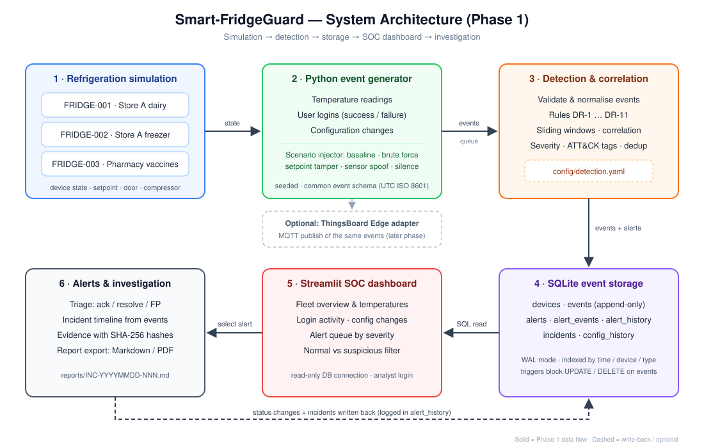

# Smart-FridgeGuard

[](https://github.com/kgiannopoulou/Smart-FridgeGuard/actions/workflows/ci.yml)

Security monitoring for a fleet of smart refrigerators, built on **ThingsBoard Edge**.
The system simulates refrigerators and user activity, detects suspicious behaviour,
raises security alerts, stores events and produces incident investigation reports.

## Architecture



Three simulated refrigerators feed a Python event generator; a detection and correlation
engine classifies events and raises alerts, everything is stored in SQLite, and a Streamlit
SOC dashboard supports alert triage and incident investigation.

## Project status

| Phase | Step | Deliverable | Status |
|-------|------|-------------|--------|
| 1 – Planning, architecture and simulation | 1. Define the project requirements | [requirements.md](requirements.md) | Done |
| | 2. Research the threat and build a threat model | [threat-model.md](threat-model.md) | Done |
| | 3. Design the system architecture | [docs/architecture.md](docs/architecture.md), [diagram](docs/architecture.svg) | Done |
| | 4. Prepare the development environment | [docs/development-setup.md](docs/development-setup.md), venv, project folders, CI | Done |
| | 5. Build the refrigerator simulation engine | `fridgeguard/simulator/`, [docs/simulation.md](docs/simulation.md) | Done |
| | 6. Build the user and activity simulator | `fridgeguard/generator/`, [docs/simulation.md](docs/simulation.md) | Done |
| 2 – Cybersecurity detection engine | 7. Build the event logging system | `fridgeguard/storage/`, [docs/event-database.md](docs/event-database.md) | Done |
| | 8. Develop the detection engine | [`fridgeguard/detection/detector.py`](fridgeguard/detection/detector.py), rules in `fridgeguard/detection/rules/`, [`config/detection.yaml`](config/detection.yaml), [docs/detection-engine.md](docs/detection-engine.md) | Done |
| | 9. Develop event correlation | [`fridgeguard/detection/correlator.py`](fridgeguard/detection/correlator.py), [`config/correlation.yaml`](config/correlation.yaml), patterns COR-001..004, [docs/correlation.md](docs/correlation.md) | Done |
| | 10. Implement alert prioritization | [`fridgeguard/detection/prioritizer.py`](fridgeguard/detection/prioritizer.py), [`config/prioritization.yaml`](config/prioritization.yaml), alert workflow, [docs/alert-management.md](docs/alert-management.md) | Done |
| 3 – SOC dashboard and incident response | 11. Build the SOC dashboard | [`dashboard/`](dashboard/app.py) (Streamlit), data layer in [`fridgeguard/dashboard/`](fridgeguard/dashboard/), [docs/soc-dashboard.md](docs/soc-dashboard.md) | Done |
| | 12. Build the incident investigation workflow | [`fridgeguard/investigation/`](fridgeguard/investigation/), [`config/investigation.yaml`](config/investigation.yaml), [report template](templates/incident-report.md), [example report](docs/examples/INV-000001.md) ([PDF](docs/examples/INV-000001.pdf)), [docs/investigation.md](docs/investigation.md) | Done |

## Quick start

```powershell
python -m venv .venv
.venv\Scripts\Activate.ps1
pip install -e ".[dev]"
python -m fridgeguard check-env
pytest
streamlit run dashboard/app.py
```

Full instructions: [docs/development-setup.md](docs/development-setup.md).

## Run the simulation

```powershell
python -m fridgeguard simulate --realtime --speed 60        # live, until Ctrl+C
python -m fridgeguard simulate --duration 3d --show activity # 3 days of data, fast
```

Three refrigerators with different operating ranges follow a thermal model (thermostat,
door openings, sensor noise). Fictional users (`store_manager`, `maintenance_tech`,
`system_admin`, `unknown_user`) log in, change settings and occasionally behave
suspiciously. Role-based access control and a maintenance window decide what is allowed.
All events go to the console, `data/events.jsonl` and the SQLite event database
`data/fridgeguard.db`. See [docs/simulation.md](docs/simulation.md).

## Detect suspicious behaviour

```powershell
python -m fridgeguard simulate --duration 7d --faults-per-day 0.5 --show none   # live detection
python -m fridgeguard alerts list
python -m fridgeguard alerts show ALR-000001
python -m fridgeguard detect                                   # re-run rules over stored events
```

| Rule | Detects | Base severity |
|------|---------|---------------|
| DET-001 | Unauthorized setpoint change | High |
| DET-002 | Multiple failed logins (5+ from one source in 5 min) | High |
| DET-003 | Temperature outside configured limits (15+ min) | High |
| DET-004 | Access outside maintenance hours | Medium |
| DET-005 | Missing device heartbeat | High |
| DET-006 | Unauthorized user configuration change | High |
| DET-007 | Planned maintenance activity (audit trail) | Info |

Thresholds, windows and severities are set in `config/detection.yaml`, not in code. Over a
simulated week the rules caught every injected unauthorized change, off-hours session,
compressor failure and outage, with no false positives. See
[docs/detection-engine.md](docs/detection-engine.md).

## Prioritize and manage alerts

```powershell
python -m fridgeguard alerts queue                                  # open alerts, most severe first
python -m fridgeguard alerts status ALR-000008 under_investigation   # assigns it to you
python -m fridgeguard alerts status ALR-000008 false_positive --note "Planned call-out, confirmed by phone"
python -m fridgeguard alerts severity ALR-000002 CRITICAL --note "Same IP seen at another store"
python -m fridgeguard alerts stats
```

| Severity | Example |
|----------|---------|
| Critical | Unauthorized configuration change followed by temperature manipulation |
| High | Repeated failed logins or serious temperature deviation (≥ 2 °C beyond the range) |
| Medium | Unusual access outside maintenance hours; refused change attempts |
| Low | Minor abnormal behaviour requiring observation (small temperature deviation) |
| Info | Normal maintenance activity |

The prioritizer classifies each alert from its rule's base severity and the context (was
the change applied? how far did the temperature go? critical device? did the temperature
react to an unauthorized change?), stores the reason, and re-classifies as the situation
develops. Alerts move through **new → under investigation → confirmed / false positive /
resolved**. Every step is assigned, needs a note where it matters, and is kept in an
append-only history. See [docs/alert-management.md](docs/alert-management.md).

## Correlate alerts into incidents

```powershell
python -m fridgeguard correlate                      # also runs after detect / simulate
python -m fridgeguard incidents list
python -m fridgeguard incidents show INC-20261117-001
python -m fridgeguard incidents review INC-20261117-001 closed --verdict true_positive --note "Owner did not log in"
```

The correlator links alerts with the events around them (same session, source IP, user or
device, close in time), follows the pivots an analyst would make (logins after failed
attempts, the rest of the session, changes before a temperature excursion, did the sensor
react to a change?) and matches ordered attack patterns: COR-001 brute force -> takeover ->
tampering (CRITICAL), COR-002 suspicious login -> change, COR-003 brute force -> login,
COR-004 change -> excursion. Each incident has a confidence score with its reasons, a
timeline, questions to verify and a recommended response. Incidents start "unverified";
analyst reviews are append-only. See [docs/correlation.md](docs/correlation.md).

## Investigate an alert (L1 SOC workflow)

```powershell
python -m fridgeguard investigate start ALR-000025           # assigns the alert to you
python -m fridgeguard investigate show INV-000001            # gathered evidence + suggested decisions
python -m fridgeguard investigate record INV-000001 authorization --decision unauthorized --note "External source guessing credentials"
python -m fridgeguard investigate record INV-000001 documentation --decision true_positive --note "..."
python -m fridgeguard investigate report INV-000001 --format pdf    # or --format md
```

For each alert the analyst works through eight steps: review the alert, identify the
affected refrigerator, examine the related events, investigate the user and source IP,
decide whether the activity was authorized, assess the potential impact, escalate to the
right team (L2 SOC, maintenance engineering, store management, IT/network) and document
the investigation. The system gathers the evidence for each step and suggests the three
judgement calls with the reasons behind them. The analyst decides. Documenting the
investigation moves the alert to confirmed / resolved / false positive.

The result is a downloadable **incident report** in Markdown or PDF that follows the SOC
template (incident ID, detection time, affected device, severity; then initial alert,
investigation performed, evidence collected, event timeline, findings, potential impact,
recommended response, escalation decision, final status). Every evidence record is
re-verified against its SHA-256 hash when the report is built. Example:
[INV-000001.md](docs/examples/INV-000001.md) · [INV-000001.pdf](docs/examples/INV-000001.pdf).
See [docs/investigation.md](docs/investigation.md).

## SOC dashboard

```powershell
streamlit run dashboard/app.py          # reads data/fridgeguard.db (or $env:FRIDGEGUARD_DB)
```

| Page | Shows |
|------|-------|
| Overview | total fridges, online / offline, active alerts, critical incidents; fleet cards, open alerts by severity, open incidents, latest alerts |
| Temperature monitoring | history per fridge with expected range, abnormal readings and excursions, device comparison |
| Security monitoring | failed and successful logins, configuration changes, suspicious IPs, unusual access times |
| Alert management | severity, timestamps, affected fridge, associated user, status; triage and severity override (audited) |
| Alert investigation | the L1 workflow for one alert step by step, suggested decisions, event timeline, Markdown and PDF report download |
| Incident investigation | event timeline, related alerts, evidence collected, analyst findings, recommended response, Markdown report |

See [docs/soc-dashboard.md](docs/soc-dashboard.md).


## Query the event database

```powershell
python -m fridgeguard events stats
python -m fridgeguard events list --status suspicious
python -m fridgeguard events list --type SETPOINT_CHANGE --device FRIDGE-001
python -m fridgeguard events verify                          # re-check SHA-256 hashes
```

Temperature telemetry and security audit events (logins, setpoint and configuration
changes with user, source IP, previous/new value and status) are stored in separate
append-only tables. See [docs/event-database.md](docs/event-database.md).

## Documentation

- [Requirements](requirements.md): functional and non-functional requirements, detection rules, traceability
- [Threat model](threat-model.md): assets, entry points, threat actors, STRIDE analysis, MITRE ATT&CK for ICS mapping, risk rating, defensive controls
- [Architecture](docs/architecture.md): components, data flow, event schema, SQLite schema, detection engine design, configuration, tech stack, security design
- [Development setup](docs/development-setup.md): tools, virtual environment, VS Code, project folders, everyday commands
- [Simulation](docs/simulation.md): refrigerator thermal model, reading format, users and roles, authentication, authorization, activity events
- [Detection engine](docs/detection-engine.md): rules DET-001…DET-007, configuration, alert grouping and evidence, results against ground truth
- [Alert management](docs/alert-management.md): severity classification INFO…CRITICAL, prioritization steps, alert statuses and workflow, triage queue
- [Event correlation](docs/correlation.md): pivots, linking, attack patterns COR-001…004, confidence score, incident reviews
- [SOC dashboard](docs/soc-dashboard.md): pages, online/offline logic, design rules, code map
- [Incident investigation](docs/investigation.md): L1 workflow, suggested decisions, escalation teams, incident report (Markdown/PDF), evidence integrity
- [Event database](docs/event-database.md): telemetry vs. security audit events, event fields and types, status, integrity, CLI and SQL access
