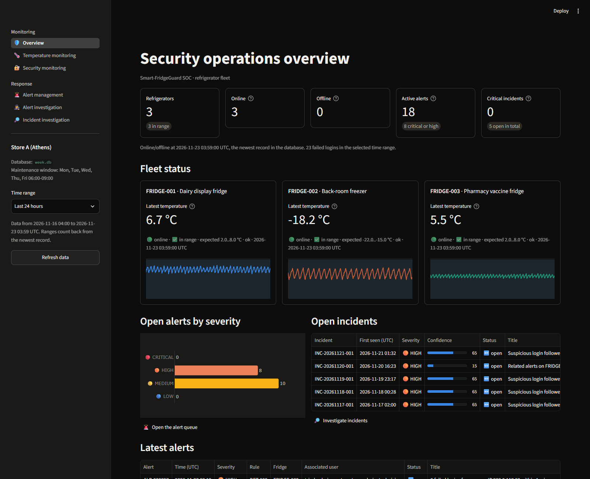
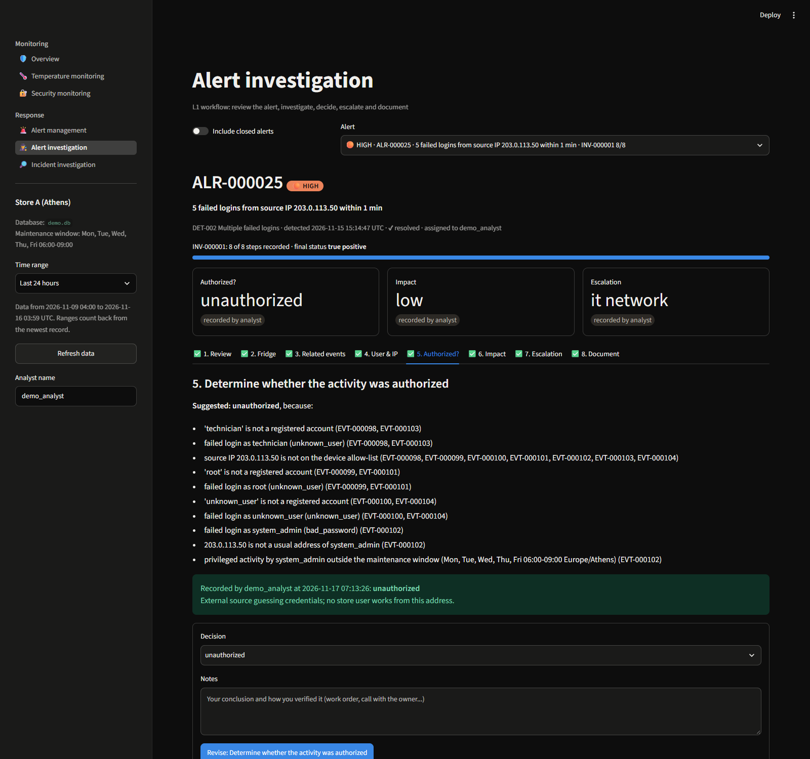

# Smart-FridgeGuard

[](https://github.com/kgiannopoulou/Smart-FridgeGuard/actions/workflows/ci.yml)


**Security monitoring for supermarket refrigerators.** Smart-FridgeGuard simulates a fleet of
connected fridges and the people who use them, detects attacks such as brute force,
unauthorized setpoint changes and tampering, correlates them into incidents, and gives a
SOC analyst a dashboard, a step-by-step investigation workflow and evidence-backed
incident reports. It is designed to plug into ThingsBoard Edge / MQTT, and a
[hardware guide](docs/hardware-guide.md) explains how a supermarket could move it to real sensors.



## Why

A smart fridge in a store is operational technology. If someone changes a vaccine fridge's
setpoint, the result is spoiled medicine or a food-safety incident. Refrigeration alarms
tell you the temperature went up; they do not tell you **who** changed what, from where, and
whether it was allowed. Smart-FridgeGuard answers those questions.

## Highlights

| | |
|---|---|
| **Threat-driven** | Requirements with traceability, STRIDE threat model, MITRE ATT&CK for ICS mapping, 20 defensive controls |
| **Realistic simulation** | Thermal model per fridge (thermostat, door openings, sensor noise), users with PBKDF2 passwords, role-based access control, maintenance window, injected attacks and faults |
| **Detection engineering** | 7 configurable rules (DET-001…007), context-based severity INFO…CRITICAL, 4 correlation patterns including a full kill chain (COR-001) |
| **Tamper-evident evidence** | Append-only SQLite tables enforced by triggers, SHA-256 per event, hashes re-verified in every report |
| **SOC workflow** | Streamlit dashboard, alert triage with audited status changes, 8-step L1 investigation, Markdown/PDF incident reports, incident-response playbooks |
| **Low-noise notifications** | Console, email and Telegram with cooldown, escalation and rate limits: a 300-attempt brute force gives 3 notifications |
| **Measured** | 10 controlled scenarios × 20 seeds: 200 / 200 runs passed, 0 false positives, 0 missed detections; ~280 automated tests in CI |

## Architecture


Three simulated refrigerators feed a Python event generator; the detection engine applies
the rules, the prioritizer sets the severity and the correlator builds incidents. Everything
is stored in SQLite; the Streamlit SOC dashboard and the notifier read from it. Details:
[docs/architecture.md](docs/architecture.md).

## Quick start

```powershell
git clone https://github.com/kgiannopoulou/Smart-FridgeGuard.git
cd Smart-FridgeGuard
python -m venv .venv
.venv\Scripts\Activate.ps1               # source .venv/bin/activate on Linux / macOS
pip install -r requirements.txt          # or: pip install -e ".[dev]" for the `fridgeguard` command

python simulator.py --duration 7d --faults-per-day 0.5 --show none   # a week of data, detection live
python correlation.py                     # link alerts into incidents
python detector.py alerts queue           # open alerts, most severe first
streamlit run app.py                      # SOC dashboard on http://localhost:8501
pytest                                    # test suite
```

Every root script is a shortcut for a `python -m fridgeguard` command, e.g.
`python detector.py` = `python -m fridgeguard detect`. Full setup:
[docs/development-setup.md](docs/development-setup.md).

## Repository structure

```
Smart-FridgeGuard/
├── app.py               # Streamlit SOC dashboard (pages in dashboard/views/)
├── simulator.py         # refrigerator + user activity simulation
├── detector.py          # detection rules and alert management
├── correlation.py       # incidents and the investigation workflow
├── database.py          # event database queries, import, integrity check
├── notifications.py     # console / email / Telegram notifications
│
├── fridgeguard/         # implementation package (simulator, generator, storage,
│                        #   detection, investigation, notifications, evaluation)
├── config/              # all thresholds, users, devices and playbooks in YAML
├── scenarios/           # system test plan TC-01…TC-10
├── data/                # SQLite database and JSONL event log (generated)
├── tests/               # pytest suite
├── reports/             # generated reports and email outbox (generated)
├── logs/                # operational log logs/fridgeguard.log (generated)
│
├── docs/                # requirements, architecture, threat model, detection rules,
│                        #   incident response, hardware guide, test results, ...
├── screenshots/         # dashboard screenshots
├── requirements.txt
├── README.md
└── .gitignore
```

## How it works

### 1. Simulate fridges and users

```powershell
python simulator.py --realtime --speed 60            # live, until Ctrl+C
python simulator.py --duration 3d --show activity    # 3 days of data, fast
```

Three refrigerators (dairy fridge, freezer, pharmacy vaccine fridge) follow a thermal
model. Fictional users (`store_manager`, `maintenance_tech`, `system_admin`,
`unknown_user`) log in, change settings and occasionally behave suspiciously; RBAC and a
maintenance window decide what is allowed. Events go to the console, `data/events.jsonl`
and `data/fridgeguard.db`. → [docs/simulation.md](docs/simulation.md)

### 2. Detect suspicious behaviour

| Rule | Detects | Base severity |
|------|---------|---------------|
| DET-001 | Unauthorized setpoint change | High |
| DET-002 | Multiple failed logins (5+ from one source in 5 min) | High |
| DET-003 | Temperature outside configured limits (15+ min) | High |
| DET-004 | Access outside maintenance hours | Medium |
| DET-005 | Missing device heartbeat | High |
| DET-006 | Unauthorized user configuration change | High |
| DET-007 | Planned maintenance activity (audit trail) | Info |

```powershell
python detector.py                       # re-run all rules over the stored events
python detector.py alerts show ALR-000001
```

Thresholds, windows and severities live in `config/detection.yaml`, not in code.
→ [docs/detection-rules.md](docs/detection-rules.md)

### 3. Prioritize and triage alerts

| Severity | Example |
|----------|---------|
| Critical | Unauthorized configuration change followed by temperature manipulation |
| High | Repeated failed logins or serious temperature deviation (≥ 2 °C beyond the range) |
| Medium | Unusual access outside maintenance hours; refused change attempts |
| Low | Minor abnormal behaviour requiring observation (small temperature deviation) |
| Info | Normal maintenance activity |

```powershell
python detector.py alerts status ALR-000008 under_investigation
python detector.py alerts status ALR-000008 false_positive --note "Planned call-out, confirmed by phone"
```

Alerts move through **new → under investigation → confirmed / false positive / resolved**,
with an append-only history. → [docs/alert-management.md](docs/alert-management.md)

### 4. Correlate alerts into incidents

```powershell
python correlation.py incidents list
python correlation.py incidents show INC-20261117-001
```

The correlator follows the pivots an analyst would make (same session, IP, user, device)
and matches ordered attack patterns: COR-001 brute force → takeover → tampering
(CRITICAL), COR-002 suspicious login → change, COR-003 brute force → login, COR-004
change → excursion. Each incident has a confidence score, a timeline and a recommended
response. → [docs/correlation.md](docs/correlation.md)

### 5. Investigate and report

```powershell
python correlation.py investigate start ALR-000025
python correlation.py investigate record INV-000001 authorization --decision unauthorized --note "External source guessing credentials"
python correlation.py investigate report INV-000001 --format pdf
```

Eight steps: review the alert, identify the fridge, examine related events, investigate
user and IP, decide authorization, assess impact, escalate, document. The system gathers the
evidence and suggests the judgement calls with reasons; the analyst decides. Example report:
[INV-000001.md](docs/examples/INV-000001.md) · [PDF](docs/examples/INV-000001.pdf).
→ [docs/investigation.md](docs/investigation.md) · playbooks in
[docs/incident-response.md](docs/incident-response.md)



### 6. Notify the right people

```powershell
python notifications.py channels        # configured channels (secrets shown as "(set)")
python notifications.py run             # notify stored alerts not handled yet
```

Console (MEDIUM+), email (HIGH+; `.eml` files in `reports/outbox/` or a real SMTP server) and
optional Telegram, deduplicated per incident with cooldown, escalation and rate limiting.
→ [docs/notifications.md](docs/notifications.md)

### 7. SOC dashboard

| Page | Shows |
|------|-------|
| Overview | fridges online / offline, active alerts, critical incidents, latest alerts |
| Temperature monitoring | history per fridge with expected range, excursions, device comparison |
| Security monitoring | failed and successful logins, configuration changes, suspicious IPs, unusual access times |
| Alert management | triage queue, status changes and severity overrides (audited) |
| Alert investigation | the 8-step L1 workflow, suggested decisions, timeline, report download |
| Incident investigation | correlated incidents, related alerts, evidence, recommended response |

→ [docs/soc-dashboard.md](docs/soc-dashboard.md) · more in [`screenshots/`](screenshots/)

### 8. Test the complete system

```powershell
python -m fridgeguard evaluate --seeds 20     # runs the test plan, writes docs/test-results.md
python database.py verify                     # re-check every event's SHA-256 hash
```

| Test | Expected result | Result |
|------|-----------------|--------|
| Normal operation (24 h) | No security alert | 0 alerts above INFO in 20 simulated days |
| Unauthorized setpoint change | Critical alert | DET-001 CRITICAL, 20 / 20 |
| Five failed logins | Brute-force alert | DET-002 HIGH, 20 / 20 |
| Temperature rises gradually | Temperature warning | DET-003, 20 / 20 |
| Device stops sending readings | Offline alert | DET-005 HIGH, 20 / 20 |
| Authorized technician changes settings | Authorized activity recorded | DET-007 INFO only, 20 / 20 |
| Suspicious login followed by configuration change | Correlated incident | COR-002, 20 / 20 |
| + full kill chain, and two boundary cases just under the thresholds | Critical incident / no alert | 20 / 20 each |

Time to detect: immediate (unauthorized change), ~80 s (brute force), ~2 min (offline),
20–43 min (temperature). The tests found two defects, both fixed.
→ [docs/test-results.md](docs/test-results.md)

## From simulation to a real supermarket

[docs/hardware-guide.md](docs/hardware-guide.md) describes three implementation levels —
an ESP32 + DS18B20 prototype, a single store with commercial sensors and an industrial IoT
gateway, and an enterprise chain with segmented OT networks and a central SIEM — plus MQTT
and Modbus integration, secure communication, segmentation, calibration and independent
temperature verification. Smart-FridgeGuard is an **independent, read-only** monitor: a real
deployment needs approval from refrigeration engineers and food-safety specialists, and it
must not replace certified refrigeration alarms or safety controls.

## Documentation

| Document | Contents |
|----------|----------|
| [Requirements](docs/requirements.md) | Functional and non-functional requirements, detection requirements DR-1…11, traceability |
| [Architecture](docs/architecture.md) | Components, data flow, event schema, database schema, configuration, repository layout, design decisions |
| [Threat model](docs/threat-model.md) | Assets, entry points, actors, STRIDE, MITRE ATT&CK for ICS, risk rating, controls |
| [Detection rules](docs/detection-rules.md) | Rule catalog, DET-001…007 logic and configuration, coverage of the requirements |
| [Incident response](docs/incident-response.md) | Roles, severity targets, escalation, playbooks PB-1…6, evidence handling |
| [Hardware guide](docs/hardware-guide.md) | Hardware components, implementation levels 1–3, protocols, segmentation, calibration, safe integration |
| [Test results](docs/test-results.md) | Test plan, detection accuracy, false positives, time to detect, defects found |
| [Alert management](docs/alert-management.md) | Severity classification, prioritization, alert statuses, triage queue |
| [Event correlation](docs/correlation.md) | Pivots, linking, COR-001…004, confidence score, incident reviews |
| [Incident investigation](docs/investigation.md) | L1 workflow, suggested decisions, incident report, evidence integrity |
| [Notifications](docs/notifications.md) | Channels, deduplication, secrets, reliability |
| [SOC dashboard](docs/soc-dashboard.md) | Pages, online/offline logic, code map |
| [Simulation](docs/simulation.md) | Thermal model, users and roles, authentication, activity events |
| [Event database](docs/event-database.md) | Telemetry vs. security events, fields, status, integrity, CLI and SQL access |
| [Development setup](docs/development-setup.md) | Tools, virtual environment, VS Code, everyday commands |
| [Interview presentation](docs/interview-presentation.md) | Pitch, 10-minute talk, demo script, design decisions, Q&A |

## Project status

| Phase | Step | Deliverable | Status |
|-------|------|-------------|--------|
| 1 – Planning, architecture and simulation | 1. Define the project requirements | [docs/requirements.md](docs/requirements.md) | Done |
| | 2. Research the threat and build a threat model | [docs/threat-model.md](docs/threat-model.md) | Done |
| | 3. Design the system architecture | [docs/architecture.md](docs/architecture.md), [diagram](docs/architecture.svg) | Done |
| | 4. Prepare the development environment | [docs/development-setup.md](docs/development-setup.md), venv, project folders, CI | Done |
| | 5. Build the refrigerator simulation engine | [`fridgeguard/simulator/`](fridgeguard/simulator/), [docs/simulation.md](docs/simulation.md) | Done |
| | 6. Build the user and activity simulator | [`fridgeguard/generator/`](fridgeguard/generator/), [docs/simulation.md](docs/simulation.md) | Done |
| 2 – Cybersecurity detection engine | 7. Build the event logging system | [`fridgeguard/storage/`](fridgeguard/storage/), [docs/event-database.md](docs/event-database.md) | Done |
| | 8. Develop the detection engine | [`fridgeguard/detection/`](fridgeguard/detection/), [`config/detection.yaml`](config/detection.yaml), [docs/detection-rules.md](docs/detection-rules.md) | Done |
| | 9. Develop event correlation | [`correlator.py`](fridgeguard/detection/correlator.py), [`config/correlation.yaml`](config/correlation.yaml), [docs/correlation.md](docs/correlation.md) | Done |
| | 10. Implement alert prioritization | [`prioritizer.py`](fridgeguard/detection/prioritizer.py), [`config/prioritization.yaml`](config/prioritization.yaml), [docs/alert-management.md](docs/alert-management.md) | Done |
| 3 – SOC dashboard and incident response | 11. Build the SOC dashboard | [`app.py`](app.py), [`dashboard/views/`](dashboard/views/), [docs/soc-dashboard.md](docs/soc-dashboard.md) | Done |
| | 12. Build the incident investigation workflow | [`fridgeguard/investigation/`](fridgeguard/investigation/), [report template](templates/incident-report.md), [example report](docs/examples/INV-000001.md), [docs/investigation.md](docs/investigation.md) | Done |
| | 13. Implement notifications | [`fridgeguard/notifications/`](fridgeguard/notifications/), [`config/notifications.yaml`](config/notifications.yaml), [docs/notifications.md](docs/notifications.md) | Done |
| 4 – Testing, documentation and presentation | 14. Test the complete system | [docs/test-results.md](docs/test-results.md), [`scenarios/`](scenarios/), [`tests/test_system.py`](tests/test_system.py) | Done |
| | 15. Create the hardware implementation guide | [docs/hardware-guide.md](docs/hardware-guide.md) | Done |
| | 16. Prepare the final portfolio and interview presentation | Repository structure, root entry points, [docs/incident-response.md](docs/incident-response.md), [docs/interview-presentation.md](docs/interview-presentation.md) | Done |

## Limitations

- All data is simulated; the MQTT / ThingsBoard Edge adapter and real hardware are designed
  ([architecture §11](docs/architecture.md#11-relationship-to-thingsboard-edge),
  [hardware guide](docs/hardware-guide.md)) but not implemented or tested.
- Not yet implemented: DR-3 (unknown source IP), DR-7 (sensor tampering cross-check),
  DR-11 (detection configuration changed), and detection of *authorised* dangerous changes
  (DR-5/DR-10) — see [coverage](docs/detection-rules.md#9-coverage-of-the-requirements).
- SMTP and Telegram were tested against a local test server and mocks, not real services.
- Single site, single process, SQLite; a supermarket chain needs the Level 3 design.

All users, IP addresses and events in this repository are fictional.
