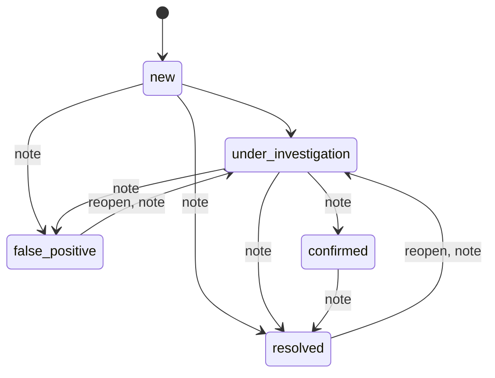

# Smart-FridgeGuard — Alert Prioritization and Management

**Phase:** 2 – Cybersecurity detection engine
**Step:** 10 – Implement alert prioritization
**Status:** Done (2026-11-15)
**Related:** [detection-engine.md](detection-engine.md) · [event-database.md](event-database.md) ·
[requirements.md](../requirements.md) FR-6

---

Not every alert deserves the same response. Step 10 adds:

1. a **severity classification** from INFO to CRITICAL that uses what else is known about
   an alert (did the change go through? how far did the temperature go? which device?
   what happened before or after?);
2. an **alert workflow** (new → under investigation → confirmed / false positive /
   resolved) with assignment, required notes and a full audit history;
3. a **triage queue** that puts the most severe open alerts first.

## 1. Quick start

```powershell
python -m fridgeguard simulate --duration 7d --faults-per-day 0.5 --show none

python -m fridgeguard alerts queue                     # open alerts, most severe first
python -m fridgeguard alerts stats                     # counts by severity and status
python -m fridgeguard alerts show ALR-000008           # evidence, severity reasons, history

python -m fridgeguard alerts status ALR-000008 under_investigation       # assigns it to you
python -m fridgeguard alerts status ALR-000008 false_positive --note "Planned call-out, confirmed by phone"
python -m fridgeguard alerts severity ALR-000002 CRITICAL --note "Same IP seen at another store"
python -m fridgeguard alerts prioritize                # re-classify after editing the config
```

The analyst name comes from `--analyst`, the `FRIDGEGUARD_ANALYST` environment variable,
or the operating-system user.

## 2. Severity classification

| Severity | Meaning | When the system assigns it |
|----------|---------|----------------------------|
| **CRITICAL** | Unauthorized configuration change followed by temperature manipulation | An unauthorized change that the device **applied** (DET-001/DET-006) and, on the same device within 2 h, a temperature excursion (DET-003). **Both** alerts become CRITICAL. |
| **HIGH** | Repeated failed logins or serious temperature deviation | DET-002 failed-login burst · DET-003 with the worst reading **≥ 2 °C** beyond the expected range · DET-005 missing heartbeat · an applied unauthorized change with no temperature effect (yet) |
| **MEDIUM** | Unusual access outside maintenance hours | DET-004 · an unauthorized change the device **refused** (nothing changed, but someone tried) · a minor deviation on a critical device |
| **LOW** | Minor abnormal behaviour requiring observation | DET-003 with the worst reading **< 2 °C** beyond the range |
| **INFO** | Normal maintenance activity | DET-007: an applied, permitted change by a technician/admin inside the maintenance window. Kept for the audit trail, hidden from the queue. |

### How an alert is classified

Each detection rule has a **base severity** (`config/detection.yaml`). The prioritizer
(`fridgeguard/detection/prioritizer.py`) then applies the steps in
[`config/prioritization.yaml`](../config/prioritization.yaml), in this order:

| Step | Applies to | Effect |
|------|------------|--------|
| 1. Base | every alert | rule severity |
| 2. Refused change | DET-001, DET-006 | no applied change in the evidence → MEDIUM |
| 3. Temperature deviation | DET-003 | worst reading from the start of the excursion until the device is back in range (max 24 h): ≥ 2 °C beyond → HIGH, less → LOW |
| 4. Critical device | DET-003, DET-005 on FRIDGE-003 (vaccines) | one level up, at most HIGH |
| 5. Change then temperature | DET-001/006 + DET-003, same device, ≤ 2 h | both CRITICAL |

CRITICAL is reserved for the sequence in step 5. A critical device raises an alert to at
most HIGH, so a 3-minute outage on the vaccine fridge is not treated like an attack that
has already changed its temperature.

Every alert stores the reason in plain language, for example:

```
severity:    HIGH   base: HIGH
why:         DET-003 base severity HIGH; serious deviation: worst reading 22.1 °C, 14.1 °C beyond the expected range (serious from 2 °C) -> HIGH
```

```
severity:    MEDIUM   base: HIGH
why:         DET-001 base severity HIGH; change was refused by the device, nothing changed -> MEDIUM
```

**Re-classification.** The classification runs when an alert is raised (it also re-checks
the other alerts on the same device, because a temperature alert can make an earlier change
alert CRITICAL) and again when detection finishes. It can therefore go up when the
temperature keeps rising, from LOW to HIGH for example. Each change is written to
`alert_history` with actor `prioritizer`.

**Analyst override.** `alerts severity` sets a severity by hand. It needs a note and locks
the alert: the prioritizer never changes it again.

**Why DET-001 and DET-006 moved from CRITICAL to HIGH.** In Step 8 every unauthorized change
was CRITICAL, including attempts the device refused. With the table above, an applied
unauthorized change is HIGH on its own and becomes CRITICAL when the temperature reacts. A
refused attempt is MEDIUM. This also matches DR-4 (High) in
[requirements.md](../requirements.md).

## 3. Alert statuses



| Status | Meaning | What else happens |
|--------|---------|-------------------|
| `new` | Raised by a rule, nobody has looked at it | default for every alert |
| `under_investigation` | An analyst is working on it | the alert is assigned to that analyst |
| `confirmed` | The analyst verified the activity is malicious or unauthorized | security events in the evidence are marked `malicious` (set by `analyst:<name>`) |
| `false_positive` | The rule fired, but the activity was legitimate | security events in the evidence are marked `normal` again |
| `resolved` | Dealt with (fixed, contained or no longer relevant) | — |

Rules enforced by `EventStore.set_alert_status`:

- Only the moves shown above are allowed. `new → confirmed`, for example, is refused:
  confirming needs an investigation first.
- A note is required for every move except starting an investigation.
- Every move, assignment and severity change is appended to `alert_history`
  (append-only, enforced by triggers), with time, actor, old and new value and note.
- Event statuses are appended to `event_status_history`, never overwritten. The detection
  verdict and the analyst verdict both stay visible (`events history EVT-…`).

Example (`alerts show ALR-000008` after triage):

```
status:      false_positive   assigned to: analyst1
...
history (3):
  2026-11-15 09:02  analyst1     status new -> under_investigation
  2026-11-15 09:02  analyst1     assigned_to - -> analyst1                assigned when the investigation started
  2026-11-15 09:02  analyst1     status under_investigation -> false_positive Planned emergency call-out; confirmed by phone with the technician
```

History times are when the analyst acted (real time). Alert and event times are simulated.

## 4. The triage queue

`alerts queue` lists alerts that are `new` or `under_investigation`, sorted by severity
(CRITICAL first), then oldest first. INFO is hidden unless `--min-severity INFO`. Filters:
`--device`, `--assigned <analyst>`, `--limit`.

`alerts list` is the full history view: every alert in time order with filters
(`--severity`, `--min-severity`, `--status`, `--rule`, `--device`, `--assigned`).

## 5. Results: one simulated week

`python -m fridgeguard simulate --duration 7d --faults-per-day 0.5 --show none` (seed 42):

```
# detection: 27 new alerts from 42 rule hits (DET-001 6, DET-002 14, DET-003 2, DET-004 8, DET-005 2, DET-007 10)
by severity: CRITICAL 0, HIGH 8, MEDIUM 10, LOW 0, INFO 9
```

`alerts queue --limit 5`:

```
Alert ID    First seen (UTC)  Severity Rule     Device      Ev.  Status              Assigned   Title
----------------------------------------------------------------------------------------------------------------------------------
ALR-000002  2026-11-16 04:22  HIGH     DET-002  FRIDGE-003    7  new                 -          5 failed logins from source IP 203.0.113.50 within 1 min
ALR-000009  2026-11-18 03:11  HIGH     DET-005  FRIDGE-002    1  new                 -          No readings from FRIDGE-002 for more than 3 min
ALR-000019  2026-11-20 17:11  HIGH     DET-003  FRIDGE-002    2  new                 -          FRIDGE-002 at -11.6 °C, above its -22.0..-15.0 °C range for 15 min
ALR-000021  2026-11-21 10:53  HIGH     DET-005  FRIDGE-003    1  new                 -          No readings from FRIDGE-003 for more than 3 min
ALR-000023  2026-11-22 12:26  HIGH     DET-003  FRIDGE-001    2  new                 -          FRIDGE-001 at 12.3 °C, above its 2.0..8.0 °C range for 15 min
(5 open alerts in the queue)
```

What changed compared with Step 8:

| | Step 8 | Step 10 |
|---|---|---|
| Alerts | 18 | 27 (the 18 detections plus 9 INFO maintenance records) |
| CRITICAL | 6 (all refused manager attempts) | 0 |
| HIGH | 8 | 8 |
| MEDIUM | 4 | 10 (the 6 refused attempts are now MEDIUM) |
| Queue (LOW and above) | – | 18 |

The 6 refused setpoint attempts no longer sit at the top as CRITICAL: nothing on the device
changed. The queue now starts with what can affect the product: the brute-force bursts, the
outages and the two compressor failures.

**No CRITICAL alerts in this week, and why.** In the simulated store, role-based access
control refuses every unauthorized change, so an applied unauthorized change never happens
in the baseline. The CRITICAL path (applied unauthorized change, then temperature excursion)
is covered by tests built from hand-made events
(`tests/test_prioritization.py::test_critical_unauthorized_change_followed_by_temperature_manipulation`).
The tests also check the cases that must **not** be CRITICAL: the change came after the
excursion, more than 2 h before it, on another device, or was refused.

No LOW alerts either: both compressor failures went far out of range. The LOW and the
critical-device MEDIUM grades are also covered by tests.

## 6. Storage

| Table / column | Content |
|----------------|---------|
| `alerts.severity` | current classification (INFO…CRITICAL) |
| `alerts.base_severity` | what the rule said |
| `alerts.severity_reason` | why, in plain language |
| `alerts.severity_locked` | 1 after an analyst override |
| `alerts.status`, `assigned_to`, `updated_at` | triage state |
| `alert_history` | every status, severity and assignment change (append-only) |
| `v_alerts.severity_rank` | 4 = CRITICAL … 0 = INFO, for sorting |

**Upgrading an existing database.** A database created by Step 8 is upgraded the first
time it is opened: the alerts table is rebuilt with the new CHECK constraints (SQLite cannot
alter them in place). Row IDs and evidence links are kept, `open` becomes `new`,
`acknowledged` becomes `under_investigation`, and `base_severity` is set to the old severity.
Run `alerts prioritize` afterwards to classify the old alerts.

## 7. Code map

| File | Responsibility |
|------|----------------|
| `fridgeguard/detection/prioritizer.py` | `Prioritizer`, `PrioritySettings`: classification steps, reasons, re-classification |
| `config/prioritization.yaml` | thresholds, windows, critical devices, target severities |
| `fridgeguard/detection/rules/maintenance_activity.py` | DET-007 informational maintenance record |
| `fridgeguard/storage/store.py` | `set_alert_status`, `set_alert_severity`, `alert_queue`, `alert_history`, `alert_counts`, schema upgrade |
| `fridgeguard/storage/schema.sql` | alerts columns, `alert_history`, `v_alerts` |
| `fridgeguard/__main__.py` | `alerts queue / status / severity / prioritize / stats` |
| `tests/test_prioritization.py` | 27 tests: every severity level, cases that must not escalate, re-classification over time, workflow transitions and notes, analyst override, append-only history, queue order, database upgrade, live vs batch, CLI |

## 8. Not yet

- The Streamlit dashboard's alert page (queue and status buttons) comes with the dashboard step.
- Event correlation (Step 9) is in progress. Grouping related alerts into incidents will
  build on the same severity levels and workflow.
