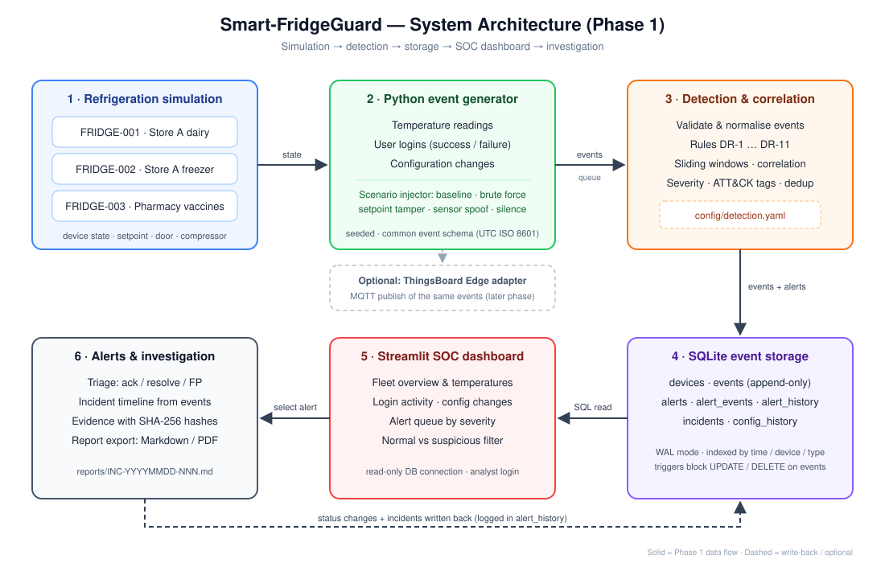
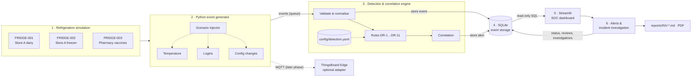
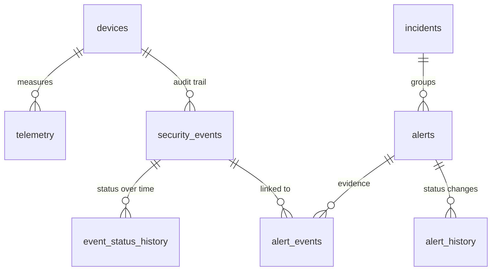
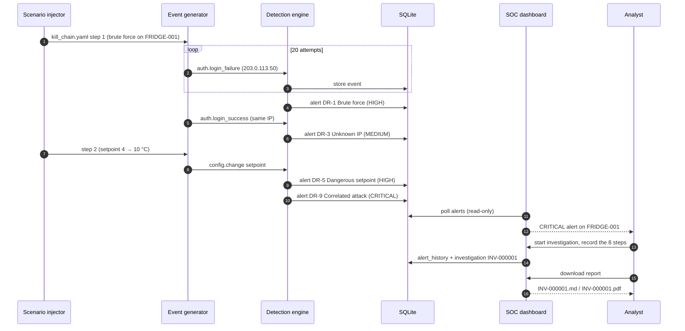

# Smart-FridgeGuard — System Architecture

**Phase:** 1 – Planning, architecture and simulation
**Step:** 3 – Design the system architecture
**Status:** Draft v1.0 (2026-11-14)
**Related:** [requirements.md](requirements.md) · [threat-model.md](threat-model.md)

---

## 1. Overview

Smart-FridgeGuard is built as a small, local security-monitoring pipeline. Six components
pass data in one direction, from simulated refrigerators to an analyst's investigation report:

1. **Refrigeration simulation:** three virtual refrigerators (FRIDGE-001, FRIDGE-002, FRIDGE-003).
2. **Python event generator:** turns device state and simulated user activity into
   temperature, login and configuration-change events.
3. **Detection and correlation engine:** validates events, applies detection rules and raises alerts.
4. **SQLite event storage:** persistent, append-only store for events, alerts and incidents.
5. **Streamlit SOC dashboard:** monitoring view for the security analyst.
6. **Alerts and incident investigation:** triage workflow and report generation.

### Design goals

| Goal | How the architecture meets it | Requirement |
|------|-------------------------------|-------------|
| Runs on one laptop, no cloud | Pure Python + SQLite file + Streamlit | NFR-7 |
| Reproducible scenarios | Seeded random generator, scenario files | NFR-7, NFR-3 |
| Clear timestamps | One event schema with device and ingest time (UTC) | NFR-1 |
| Reliable, tamper-evident storage | Append-only tables enforced by SQLite triggers | NFR-2, NFR-5 |
| Configurable detection | All thresholds in `config/detection.yaml` | NFR-4 |
| Separation of normal and suspicious | Every event has a classification and a ground-truth label | NFR-3 |
| Replaceable parts | Components talk through small interfaces (event queue, repository layer) | — |

## 2. Architecture diagram



The same flow as a Mermaid diagram (renders on GitHub):



## 3. Components

### 3.1 Refrigeration simulation

| | |
|---|---|
| **Responsibility** | Model the physical state of each refrigerator. |
| **Implementation** | `fridgeguard/simulator/fridge.py` (one `Fridge` per device), `fleet.py`. Details: [simulation.md](simulation.md). |
| **State per device** | `device_id`, name, location, type (fridge/freezer), setpoint, current temperature, door open/closed, compressor on/off, firmware version, alarm thresholds, allowed IP list, online flag. |
| **Behaviour** | Each tick (default 10 s simulated), temperature moves toward the setpoint when the compressor runs and drifts toward room temperature when the door is open or cooling fails. Small Gaussian noise makes readings realistic. |
| **Requirements** | FR-1, FR-2 |

Default fleet (`config/devices.yaml`):

| Device | Location | Type | Setpoint | Safe range |
|--------|----------|------|----------|------------|
| FRIDGE-001 | Store A, dairy aisle | Fridge | 4 °C | 2–8 °C |
| FRIDGE-002 | Store A, back room | Freezer | −18 °C | −22 to −15 °C |
| FRIDGE-003 | Pharmacy, vaccine storage | Medical fridge | 5 °C | 2–8 °C |

The fleet size is configurable; more devices are added by extending `devices.yaml` (FR-1).

### 3.2 Python event generator

| | |
|---|---|
| **Responsibility** | Produce events from device state and simulated user activity. |
| **Implementation** | `fridgeguard/generator/auth.py` (users, passwords, RBAC, audit events), `activity.py` (daily routines, anomalies); runner in `fridgeguard/simulation.py`. Details: [simulation.md](simulation.md). |
| **Event types** | `telemetry.temperature`, `auth.login_success`, `auth.login_failure`, `auth.logout`, `config.change`, `device.heartbeat` |
| **Normal activity** | Staff log in during working hours from known IPs; technicians occasionally adjust a setpoint within the safe range. |
| **Attack scenarios** | Loaded from `scenarios/*.yaml`. Each step has a time offset, target device and action (see 3.2.1). |
| **Output** | Events in the common schema (section 5), pushed onto an in-process `queue.Queue`. |
| **Modes** | `realtime` (sleeps between ticks, for live dashboard demos) and `fast` (simulates hours in seconds, for tests). |
| **Requirements** | FR-2, FR-3, FR-4, NFR-1, NFR-3, NFR-7 |

#### 3.2.1 Scenarios

Scenarios link the threat model to the simulation. Each event generated by a scenario
carries the label `scenario` (ground truth), which the detection engine never reads.

| Scenario file | Threat (threat-model.md) | What happens | Expected rules |
|---------------|--------------------------|--------------|----------------|
| `baseline.yaml` | — | Normal operation only | none |
| `brute_force.yaml` | T-3 | 20 failed logins in 3 min from one IP, then a success | DR-1 (+ DR-3) |
| `stolen_credentials.yaml` | T-2 | Valid login at 02:30 from unknown IP, setpoint 4 → 10 °C | DR-2, DR-3, DR-5, DR-9 |
| `compromised_controller.yaml` | T-4 | Alarm threshold widened, cooling off, temperature rises | DR-6, DR-10 |
| `sensor_spoofing.yaml` | T-6 | Readings jump 4 → 18 → 4 °C, then constant values | DR-7 |
| `network_outage.yaml` | T-5 | FRIDGE-002 stops reporting for 5 min | DR-8 |
| `kill_chain.yaml` | T-3 → T-2 → T-4 → T-7 | Full chain from threat-model.md §8 | DR-1, DR-3, DR-5, DR-9 |

### 3.3 Detection and correlation engine

| | |
|---|---|
| **Responsibility** | Turn the event stream into classified events and security alerts. |
| **Implementation** | `fridgeguard/detection/detector.py` (engine) and one module per rule type in `fridgeguard/detection/rules/`. Details: [detection-rules.md](detection-rules.md). |
| **Input** | Stored events in time order: live, right after each event is stored, or as a batch over the whole database. |
| **Output** | Alerts with linked evidence, and status verdicts on security events, written through the event store. |
| **Requirements** | FR-5, FR-6, NFR-3, NFR-4 |

> **Implemented in Step 8** as rules DET-001…DET-006, configured in `config/detection.yaml`
> (mapping to DR-x in [detection-rules.md §9](detection-rules.md#9-coverage-of-the-requirements)).
> Steps 1–3 below are done by the event store (Step 7), and classification uses the
> append-only `event_status_history` table. Correlation (DR-9), configuration integrity (DR-11)
> and the severity increase for the medical fridge are still planned.

Processing steps for each event:

1. **Validate:** check schema, required fields, known `device_id`, sane value types.
   Invalid events are stored with `classification = 'invalid'` instead of being dropped,
   because malformed input can itself be an attack signal.
2. **Normalise:** set `ts_ingest` (server UTC time), mask secrets, compute the event hash.
3. **Store** the event (append-only).
4. **Evaluate rules:** each rule receives the event plus a per-device state object.
5. **Correlate:** combine earlier rule hits into higher-level alerts (DR-9).
6. **Classify:** update the event's classification in a separate table
   (`event_classification`) so the original event row is never modified.
7. **Alert:** create or update an alert, with de-duplication.

Rule types:

| Type | Rules | How it works |
|------|-------|--------------|
| Single-event | DR-2, DR-3, DR-4, DR-5, DR-10 | Decision from one event plus static config (hours, allow-list, roles, limits). |
| Sliding window | DR-1, DR-6, DR-7 | Keeps a per-device `deque` of recent events and checks counts or durations within the window. |
| Absence | DR-8 | Background check every tick compares `now − last_seen` with 3 × reporting interval. |
| Correlation | DR-9 | Looks for a suspicious login hit followed by a config change on the same device within the window. |
| Configuration integrity | DR-11 | At start-up and on every reload, hashes the detection-related config files and compares them with the last entry in `config_history`. |

Every rule implements the same interface:

```python
class Rule:                               # fridgeguard/detection/rules/base.py
    type_name: str                        # "failed_logins", used in detection.yaml
    rule_id: str                          # "DET-002", from the config
    severity: str                         # LOW | MEDIUM | HIGH | CRITICAL
    attack: list[str]                     # ["T1110"]

    def evaluate(self, record: Record) -> list[RuleHit]: ...   # every stored event
    def advance(self, now: datetime) -> list[RuleHit]: ...     # time moved on (absence rules)
```

Per-device or per-source state (sliding windows, last-seen times) lives inside each rule object.

**De-duplication:** hits from the same rule for the same subject (device, source IP or
user) within `dedup_window_s` are grouped into one alert; the new records are linked as
evidence and the evidence count and last-seen time grow (view `v_alerts`).

**Severity** comes from the rule (base severity) and is then classified by the
prioritizer (Step 10, `fridgeguard/detection/prioritizer.py`): refused changes are lowered,
temperature excursions are graded by deviation, alerts on the medical fridge (FRIDGE-003)
are raised one level up to High, and an unauthorized change followed by a temperature
excursion on the same device is Critical. Details: [alert-management.md](alert-management.md).

### 3.4 SQLite event storage

| | |
|---|---|
| **Responsibility** | Persistent storage for all events, alerts, incidents and audit history. |
| **Implementation** | `fridgeguard/storage/` with `schema.sql`, `normalize.py`, `store.py` (`EventStore`). File: `data/fridgeguard.db`. Details: [event-database.md](event-database.md). |
| **Why SQLite** | Zero setup, single file, transactional, fast enough for thousands of events per second at this scale, readable by Streamlit and pandas. |
| **Concurrency** | WAL mode so the pipeline writes while the dashboard reads. One writer process; the dashboard opens the database read-only (`mode=ro`). |
| **Integrity** | Triggers reject `UPDATE`/`DELETE` on `telemetry`, `security_events`, `event_status_history` and `rejected_events` (and later `alert_events`, `alert_history`, `config_history`). |
| **Requirements** | FR-7, NFR-2, NFR-5 |

Schema overview. Telemetry and security audit events are stored in separate tables
(implemented in Step 7); alerts and incidents follow in later steps.



### 3.5 Streamlit SOC dashboard

| | |
|---|---|
| **Responsibility** | Show the analyst what is happening, now and historically. |
| **Implementation** | **Implemented in Step 11** ([soc-dashboard.md](soc-dashboard.md)): `app.py` registers the pages in `dashboard/views/` with `st.navigation` (not `pages/`, which Streamlit would auto-discover a second time). Data functions are in `fridgeguard/dashboard/data.py`, without Streamlit, and are unit-tested. |
| **Data access** | Read-only connection; queries cached with `st.cache_data`, keyed on the database file's modification time so new data shows on refresh. Audited actions open the database for writing for that one action. |
| **Requirements** | FR-8, NFR-3 |

Pages:

| Page | Content |
|------|---------|
| Overview | Total fridges, online / offline (same 3-min heartbeat as DET-005), active alerts, critical incidents; one card per fridge; open alerts by severity; open incidents; latest alerts. |
| Temperature monitoring | History per device with the expected range, abnormal readings and excursions, device comparison. |
| Security monitoring | Failed / successful logins, configuration changes, suspicious IPs, unusual access times (heatmap). |
| Alert management | Triage queue (severity, time, fridge, user, status), evidence, history, status and severity changes. |
| Alert investigation | Step 12 L1 workflow for one alert, Markdown / PDF report (component 6). |
| Incident investigation | Correlated incident: timeline, related alerts, evidence, analyst findings, recommended response. |

### 3.6 Alerts and incident investigation

| | |
|---|---|
| **Responsibility** | Alert triage, grouping alerts into incidents and generating reports. |
| **Implementation** | Triage in `fridgeguard/storage/store.py` + `fridgeguard/detection/prioritizer.py` (Step 10); incidents in `fridgeguard/detection/correlator.py` (Step 9); investigation in `fridgeguard/investigation/` (Step 12): `case.py` (evidence gathering and suggestions), `workflow.py` (steps, final status → alert status), `report.py` (Markdown and PDF from the same blocks). Blank template: `templates/incident-report.md`. |
| **Triage** | **Implemented in Step 10** ([alert-management.md](alert-management.md)): status `new → under_investigation → confirmed / false_positive / resolved`, assignment, required notes, severity INFO…CRITICAL from `config/prioritization.yaml`. Every change is written to `alert_history` with analyst and timestamp. |
| **Incidents** | **Implemented in Step 9** ([correlation.md](correlation.md)): related alerts and events grouped into `INC-YYYYMMDD-NNN` by pivots, linking and attack patterns COR-001…004, with a confidence score and append-only analyst reviews. |
| **Investigation** | **Implemented in Step 12** ([investigation.md](investigation.md)): one `INV-NNNNNN` per alert; 8 L1 steps (review, fridge, related events, user/IP, authorized?, impact, escalation, documentation) recorded append-only; suggested decisions with reasons; the final status moves the alert. |
| **Timeline** | Security events on the device or from the same sources/sessions from 2 h before to 1 h after the alert, excursion start/end, the alert, triage changes and analyst steps (`config/investigation.yaml`). |
| **Report** | Markdown and PDF (fpdf2) built from the same section blocks, following the SOC template: header (incident ID, detection time, device, severity) + 1 initial alert, 2 investigation performed, 3 evidence, 4 timeline, 5 findings, 6 impact, 7 recommended response, 8 escalation, 9 final status. |
| **Evidence integrity** | Every evidence record is re-verified against its SHA-256 hash when the report is built; the report states the result and a SHA-256 of the whole evidence set. |
| **Requirements** | FR-6, FR-9, NFR-5 |

### 3.7 Notifications

| | |
|---|---|
| **Responsibility** | Tell the analyst about important alerts without flooding them. |
| **Implementation** | **Implemented in Step 13** ([notifications.md](notifications.md)): `fridgeguard/notifications/`. The detector's `on_alert` hook feeds every rule hit to the `Notifier`, which sends through console, email (`.eml` file or SMTP) and optional Telegram channels. |
| **Deduplication** | Key = correlated incident, or rule + subject. Duplicates within a 1-h cooldown are suppressed, escalations are sent at once, continuing activity gets an hourly reminder with the held-back count, and a per-channel rate limit applies (CRITICAL exempt). |
| **State** | Append-only `notifications` table: every decision (sent / suppressed / failed) with its reason; re-runs never notify twice; failures are retried by `notify run`. |
| **Security** | Secrets only from the environment / `.env`; never printed or stored. |
| **Requirements** | FR-6 |

## 4. Data flow

### 4.1 Normal event flow

1. Simulator tick updates FRIDGE-00x state.
2. Generator creates `telemetry.temperature` event, `ts_device` = simulated device clock.
3. Event goes on the queue.
4. Detection pipeline validates it, sets `ts_ingest`, stores it.
5. Rules evaluate; no hit → classification `normal`.
6. Dashboard picks up the new row on its next refresh.

### 4.2 Attack flow: brute force followed by setpoint change



### 4.3 Communication between components

| From → To | Mechanism (Phase 1) | Format | Later option |
|-----------|---------------------|--------|--------------|
| Simulator → Generator | Direct method calls (same process) | Python objects | — |
| Generator → Detection | `queue.Queue` | `Event` dataclass | MQTT topic `fridgeguard/<device>/events` via ThingsBoard Edge |
| Detection → SQLite | Repository layer, parameterised SQL | Rows | PostgreSQL / TimescaleDB |
| SQLite → Dashboard | Read-only connection | pandas DataFrame | REST API |
| Investigation → SQLite | `EventStore` methods (write access limited to alert status, incident reviews and investigation entries, all append-only) | Rows | — |
| Investigation → Files | `report.py`: one block model rendered to Markdown and to PDF (fpdf2) | Markdown, PDF | — |

The generator, simulator and detection engine run in one process (`fridgeguard run`).
The dashboard runs as a second process (`streamlit run app.py`).
SQLite is the only shared state between the two.

## 5. Common event schema

All events use one envelope, so every component and every report reads the same fields.

```json
{
  "event_id": "8f14e45f-ceea-4e7a-9b3a-1c2d3e4f5a6b",
  "event_type": "config.change",
  "device_id": "FRIDGE-001",
  "ts_device": "2026-11-14T02:31:07.412Z",
  "ts_ingest": "2026-11-14T02:31:07.455Z",
  "actor": "m.papadopoulou",
  "source_ip": "203.0.113.50",
  "payload": {
    "parameter": "setpoint_c",
    "old_value": 4.0,
    "new_value": 10.0,
    "change_source": "web_ui"
  },
  "scenario": "kill_chain",
  "hash": "sha256:5e8f…"
}
```

| Field | Type | Notes |
|-------|------|-------|
| `event_id` | UUID v4 | Unique; primary key. |
| `event_type` | string | One of the types in 3.2. |
| `device_id` | string | Must exist in `devices`. |
| `ts_device` | ISO 8601 UTC, ms | Time reported by the device (can be wrong or manipulated). |
| `ts_ingest` | ISO 8601 UTC, ms | Time the engine received it (trusted). Gap between the two is checked (C-12). |
| `actor` | string / null | Username for logins and config changes; null for telemetry. |
| `source_ip` | string / null | Where the action came from. |
| `payload` | JSON object | Type-specific data (see below). |
| `scenario` | string | Ground-truth label from the simulator; `baseline` for normal activity. Used only for evaluation. |
| `hash` | string | SHA-256 over the canonical JSON of all other fields. |

Payloads:

| Event type | Payload fields |
|------------|----------------|
| `telemetry.temperature` | `temperature_c`, `setpoint_c`, `expected_min_c`, `expected_max_c`, `status`, `door_open`, `compressor_on` |
| `auth.login_success` / `auth.login_failure` | `method` (password, pin, token), `reason` (failure only), `role`, `session_id` (success only), `within_maintenance_window` |
| `auth.logout` | `session_s` |
| `config.change` | `parameter`, `old_value`, `new_value`, `change_source`, `result` (applied / denied / rejected), `role`, `permission`, `authorized`, `within_maintenance_window`, `session_id` |
| `device.heartbeat` | `firmware`, `uptime_s` |

Passwords are never part of any event. Tokens, if present, are masked to the first four characters.

## 6. Database schema

> **Implemented in Step 7.** The event tables are in
> [`fridgeguard/storage/schema.sql`](../fridgeguard/storage/schema.sql) and documented in
> [event-database.md](event-database.md). They replace the single `events` table and
> `event_classification` table sketched below. Telemetry and security audit events are now
> separate tables (`telemetry`, `security_events`), and status is kept as an append-only
> history (`event_status_history`). Later steps implemented the rest differently from the
> sketch: `alerts` + `alert_evidence` + `alert_history` (Steps 8 and 10,
> [alert-management.md](alert-management.md)), `incidents` + `incident_members` +
> `incident_reviews` (Step 9, [correlation.md](correlation.md)) and `investigations` +
> `investigation_entries` (Step 12, [investigation.md](investigation.md)). `config_history`
> is still a plan.

```sql
PRAGMA journal_mode = WAL;
PRAGMA foreign_keys = ON;

CREATE TABLE devices (
    device_id     TEXT PRIMARY KEY,
    name          TEXT NOT NULL,
    location      TEXT NOT NULL,
    device_type   TEXT NOT NULL CHECK (device_type IN ('fridge','freezer','medical_fridge')),
    safe_min_c    REAL NOT NULL,
    safe_max_c    REAL NOT NULL,
    created_at    TEXT NOT NULL
);

CREATE TABLE events (
    event_id      TEXT PRIMARY KEY,
    event_type    TEXT NOT NULL,
    device_id     TEXT NOT NULL REFERENCES devices(device_id),
    ts_device     TEXT NOT NULL,
    ts_ingest     TEXT NOT NULL,
    actor         TEXT,
    source_ip     TEXT,
    payload       TEXT NOT NULL,          -- JSON
    scenario      TEXT NOT NULL DEFAULT 'baseline',
    hash          TEXT NOT NULL
);
CREATE INDEX idx_events_device_time ON events(device_id, ts_ingest);
CREATE INDEX idx_events_type_time   ON events(event_type, ts_ingest);

CREATE TABLE event_classification (
    event_id       TEXT PRIMARY KEY REFERENCES events(event_id),
    classification TEXT NOT NULL CHECK (classification IN ('normal','suspicious','malicious','invalid')),
    rule_ids       TEXT                   -- JSON array, e.g. ["DR-1","DR-9"]
);

CREATE TABLE alerts (
    alert_id      TEXT PRIMARY KEY,       -- ALR-000123
    rule_id       TEXT NOT NULL,
    severity      TEXT NOT NULL CHECK (severity IN ('LOW','MEDIUM','HIGH','CRITICAL')),
    device_id     TEXT NOT NULL REFERENCES devices(device_id),
    title         TEXT NOT NULL,
    description   TEXT NOT NULL,
    attack_ids    TEXT NOT NULL,          -- JSON array of ATT&CK technique IDs
    status        TEXT NOT NULL DEFAULT 'open'
                  CHECK (status IN ('open','acknowledged','resolved','false_positive')),
    first_seen    TEXT NOT NULL,
    last_seen     TEXT NOT NULL,
    hit_count     INTEGER NOT NULL DEFAULT 1,
    incident_id   TEXT REFERENCES incidents(incident_id)
);
CREATE INDEX idx_alerts_status_sev ON alerts(status, severity);

CREATE TABLE alert_events (
    alert_id      TEXT NOT NULL REFERENCES alerts(alert_id),
    event_id      TEXT NOT NULL REFERENCES events(event_id),
    PRIMARY KEY (alert_id, event_id)
);

CREATE TABLE alert_history (
    id            INTEGER PRIMARY KEY AUTOINCREMENT,
    alert_id      TEXT NOT NULL REFERENCES alerts(alert_id),
    ts            TEXT NOT NULL,
    analyst       TEXT NOT NULL,
    old_status    TEXT,
    new_status    TEXT NOT NULL,
    note          TEXT
);

CREATE TABLE incidents (
    incident_id   TEXT PRIMARY KEY,       -- INC-20261114-001
    title         TEXT NOT NULL,
    created_at    TEXT NOT NULL,
    created_by    TEXT NOT NULL,
    status        TEXT NOT NULL DEFAULT 'open' CHECK (status IN ('open','closed')),
    summary       TEXT,
    report_path   TEXT,
    evidence_hash TEXT
);

CREATE TABLE config_history (            -- changes to detection settings (NFR-4, threat T-7)
    id            INTEGER PRIMARY KEY AUTOINCREMENT,
    ts            TEXT NOT NULL,
    changed_by    TEXT NOT NULL,
    file          TEXT NOT NULL,
    old_hash      TEXT,
    new_hash      TEXT NOT NULL,
    diff          TEXT NOT NULL
);

-- Append-only enforcement (NFR-2, control C-15)
CREATE TRIGGER events_no_update BEFORE UPDATE ON events
BEGIN SELECT RAISE(ABORT, 'events are append-only'); END;
CREATE TRIGGER events_no_delete BEFORE DELETE ON events
BEGIN SELECT RAISE(ABORT, 'events are append-only'); END;
-- same pair of triggers for alert_events, alert_history and config_history
```

Retention (NFR-2) is handled by a separate maintenance command that archives old rows to a
dated export file before removing them; it temporarily drops and recreates the triggers and
records the action in `config_history`.

## 7. Configuration

| File | Purpose |
|------|---------|
| `config/devices.yaml` | Fleet definition: devices, locations, setpoints, safe ranges, allowed IPs. |
| `config/detection.yaml` | Rule thresholds, windows, severities, working hours, de-dup window. |
| `config/users.yaml` | Simulated users and roles (user, technician, admin). No real passwords. |
| `config/prioritization.yaml` | Severity classification INFO…CRITICAL from rule and context (Step 10). |
| `config/correlation.yaml` | Pivots, linking windows, attack patterns COR-001…004, confidence (Step 9). |
| `config/investigation.yaml` | Investigation context windows, escalation teams, playbooks per rule (Step 12). |
| `config/notifications.yaml` | Notification channels, thresholds, cooldown and rate limits (Step 13). |
| `scenarios/*.yaml` | System test plan TC-01…TC-10 (Step 14). |
| `.env` | Secrets (dashboard analyst password hash, SMTP/Telegram credentials, optional ThingsBoard tokens). Git-ignored. |

The implemented rules are in [`config/detection.yaml`](../config/detection.yaml) (DET-001…DET-007,
see [detection-rules.md](detection-rules.md)). The original design sketch below, written in
terms of the DR-x requirements, is kept for the rules that are still planned:

```yaml
dedup_window_s: 600
working_hours: { start: "06:00", end: "23:00", timezone: "Europe/Athens" }

rules:
  DR-1_brute_force:        { enabled: true, failures: 5, window_s: 300, severity: HIGH }
  DR-2_off_hours_login:    { enabled: true, severity: MEDIUM }
  DR-3_unknown_ip:         { enabled: true, severity: MEDIUM }
  DR-4_unauthorised_change:{ enabled: true, permissions: users.yaml, missing_auth: investigate, severity: HIGH }
  DR-5_dangerous_setpoint: { enabled: true, max_fridge_c: 8.0, max_freezer_c: -15.0, severity: HIGH }
  DR-6_out_of_range:       { enabled: true, duration_s: 900, severity: HIGH }
  DR-7_sensor_tamper:      { enabled: true, max_jump_c: 10.0, min_c: -40.0, max_c: 50.0, severity: HIGH }
  DR-8_device_silence:     { enabled: true, missed_intervals: 3, severity: MEDIUM }
  DR-9_correlated_attack:  { enabled: true, window_s: 600, severity: CRITICAL }
  DR-10_alarm_widened:     { enabled: true, severity: HIGH }
  DR-11_detection_config:  { enabled: true, files: [detection.yaml, devices.yaml, users.yaml], severity: HIGH }
```

On start-up the engine hashes each config file and compares it with the last entry in
`config_history`; any difference is recorded (who/when/diff) and raises a DR-11 alert.
This covers threat T-7 (detection thresholds quietly raised). `devices.yaml` (allow-lists)
and `users.yaml` (roles, maintenance window) are included because they also change what
the rules detect.

## 8. Repository layout

Final layout (Step 16). The root scripts are thin entry points; the implementation lives in
the `fridgeguard/` package so it can be imported, tested and installed.

```
Smart-FridgeGuard/
├── app.py                     # Streamlit SOC dashboard entry point (pages in dashboard/views/)
├── simulator.py               # = python -m fridgeguard simulate
├── detector.py                # = python -m fridgeguard detect | alerts
├── correlation.py             # = python -m fridgeguard correlate | incidents | investigate
├── database.py                # = python -m fridgeguard events
├── notifications.py           # = python -m fridgeguard notify
│
├── fridgeguard/               # implementation package (CLI: python -m fridgeguard)
│   ├── simulator/             # thermal model, fleet, device faults
│   ├── generator/             # users, PBKDF2 auth, RBAC, activity and anomalies
│   ├── simulation.py, sinks.py
│   ├── storage/               # schema.sql, normalize.py, store.py (EventStore)
│   ├── detection/             # detector.py, rules/, prioritizer.py, correlator.py
│   ├── investigation/         # case.py, workflow.py, report.py (Markdown + PDF)
│   ├── notifications/         # notifier.py, channels.py (console, email, Telegram)
│   ├── evaluation/            # system test harness (scenario.py, runner.py, report.py)
│   ├── dashboard/             # dashboard data layer (no Streamlit)
│   └── logs.py                # operational log -> logs/fridgeguard.log
├── dashboard/views/           # one file per dashboard page (not pages/: auto-discovery)
├── config/                    # devices, users, detection, prioritization, correlation,
│                              # investigation, notifications (*.yaml)
├── scenarios/                 # system test plan TC-01..TC-10
├── templates/                 # blank incident-report template
│
├── data/                      # SQLite database and JSONL event log (git-ignored)
├── tests/                     # pytest suite (unit, CLI, dashboard, system tests)
├── reports/                   # generated reports and email outbox (git-ignored)
├── logs/                      # operational log (git-ignored)
│
├── docs/
│   ├── requirements.md, architecture.md (+ .svg), threat-model.md
│   ├── detection-rules.md, alert-management.md, correlation.md
│   ├── incident-response.md, investigation.md, notifications.md
│   ├── hardware-guide.md, test-results.md, interview-presentation.md
│   ├── simulation.md, event-database.md, soc-dashboard.md, development-setup.md
│   └── examples/              # example incident report (MD/PDF), example email
├── screenshots/               # dashboard screenshots
├── requirements.txt, pyproject.toml
├── README.md
└── .gitignore, .env.example, .github/workflows/ci.yml
```

## 9. Technology stack

| Concern | Choice | Reason |
|---------|--------|--------|
| Language | Python 3.12 | One language for simulation, detection, storage and UI. |
| Data model | `dataclasses` + `pydantic` for validation | Typed events; schema validation at the entry point. |
| Configuration | YAML (`PyYAML`) | Readable, easy to change thresholds. |
| Storage | SQLite 3 (standard library `sqlite3`) | No server, single file, transactions, triggers. |
| Dashboard | Streamlit + Plotly + pandas | Fast to build interactive SOC views in Python. |
| Reports | Python block model → Markdown and PDF (fpdf2) | One report definition, two formats that always match; fpdf2 is pure Python (no system libraries). |
| CLI | `argparse` | Simple entry point: `python -m fridgeguard run --scenario kill_chain`. |
| Tests | `pytest` | Each rule tested against its scenario and against the baseline. |
| Container (optional) | Docker Compose: `engine` + `dashboard` sharing a volume | One-command start (NFR-7). |
| IoT platform (optional) | ThingsBoard Edge CE via MQTT | Real IoT ingestion path in a later phase. |

## 10. Security design

How the architecture applies the controls from [threat-model.md](threat-model.md) §10:

| Control | Architecture decision |
|---------|-----------------------|
| C-2 per-device tokens | Each device in `devices.yaml` has its own token reference in `.env`; used by the ThingsBoard adapter. |
| C-5 role separation | Engine is the only writer of events and alerts; dashboard is read-only except for triage actions, which go through `triage.py` and are logged. |
| C-10 detection rules | Section 3.3. |
| C-11 audit log | Logins and config changes are first-class events; triage actions go to `alert_history`. |
| C-12 time comparison | Both `ts_device` and `ts_ingest` stored; a gap above a threshold is flagged by DR-7. |
| C-13 heartbeat | DR-8 absence check. |
| C-14 plausibility | DR-7 rate-of-change and physical-limit checks. |
| C-15 append-only + hashing | SQLite triggers; per-event SHA-256; evidence hash on reports. |
| C-20 secrets | `.env` git-ignored, `.env.example` committed; masking in the normaliser; no passwords in events. |
| Input validation | Pydantic schema at the pipeline entry; parameterised SQL only. |
| Dashboard access | Streamlit app requires analyst login (password hash from `.env`); binds to `localhost` by default. |

## 11. Relationship to ThingsBoard Edge

ThingsBoard Edge was chosen in [requirements.md](requirements.md) as the IoT foundation.
In Phase 1 the lab runs **without** it so the detection logic can be developed and tested
in pure Python. The architecture keeps a clean seam for it:

- The generator writes to an `EventSink` interface. Phase 1 uses `QueueSink`;
  a later `MqttSink` publishes the same events to ThingsBoard Edge
  (`v1/devices/me/telemetry` with each device's own access token).
- ThingsBoard can then provide device management, its own alarms and dashboards, while
  Smart-FridgeGuard's engine consumes the events (via ThingsBoard's rule-chain REST/MQTT
  integration) for security detection and investigation.

## 12. Design decisions

| # | Decision | Alternatives considered | Reason |
|---|----------|-------------------------|--------|
| D-1 | Single Python process for simulation, generation and detection | Separate services with a message broker | Simpler to run and debug; the queue interface allows splitting later. |
| D-2 | SQLite for storage | PostgreSQL, InfluxDB | No server to install; enough for a 3-device lab; triggers give append-only behaviour. |
| D-3 | Streamlit for the dashboard | Grafana, ThingsBoard dashboard, React | Python-only, quick to build investigation workflows, not only charts. |
| D-4 | Rule-based detection with YAML thresholds | Machine-learning anomaly detection | Explainable alerts and clear evidence (NFR-5); ML can be added later. |
| D-5 | Classification stored in a separate table | Column on `events` | Keeps `events` strictly append-only. |
| D-6 | Ground-truth `scenario` label on events | No label | Allows measuring detection accuracy (true/false positives) per scenario. |
| D-7 | ThingsBoard Edge as an optional adapter in Phase 1 | Mandatory from the start | Detection can be built and tested without running the IoT platform. |

## 13. Traceability

| Requirement | Component(s) |
|-------------|--------------|
| FR-1 Simulate multiple refrigerators | 3.1 |
| FR-2 Temperature readings | 3.1, 3.2 |
| FR-3 User logins | 3.2 |
| FR-4 Configuration changes | 3.2, 3.4 |
| FR-5 Suspicious activity | 3.3 |
| FR-6 Security alerts | 3.3, 3.4, 3.6 |
| FR-7 Event storage | 3.4 |
| FR-8 Dashboard | 3.5 |
| FR-9 Investigation reports | 3.6 |
| NFR-1 Timestamps | §5 schema |
| NFR-2 Reliable storage | 3.4, §6 |
| NFR-3 Normal vs suspicious | 3.3, `event_classification`, `scenario` label |
| NFR-4 Configurable thresholds | §7 |
| NFR-5 Investigation evidence | 3.6, `alert_events`, hashes |
| NFR-6 Credentials and logs | §10 |
| NFR-7 Reproducibility | 3.2 scenarios, §9 Docker Compose |
