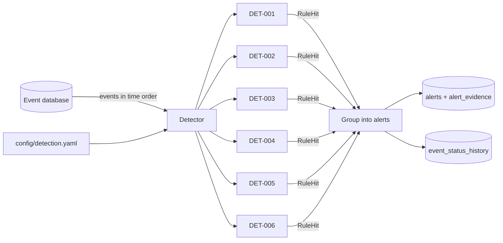

# Smart-FridgeGuard — Detection Engine

**Phase:** 2 – Cybersecurity detection engine
**Step:** 8 – Develop the detection engine
**Status:** Done (2026-11-14)
**Related:** [requirements.md](../requirements.md) FR-5/FR-6 · [threat-model.md](../threat-model.md) ·
[event-database.md](event-database.md)

---

## 1. Quick start

```powershell
# Simulate a week with device faults; detection runs live and prints alerts
python -m fridgeguard simulate --duration 7d --faults-per-day 0.5 --show none

python -m fridgeguard alerts list                     # all alerts
python -m fridgeguard alerts list --severity CRITICAL
python -m fridgeguard alerts show ALR-000001          # one alert with its evidence
python -m fridgeguard alerts rules                    # configured rules
python -m fridgeguard detect                          # re-run all rules over stored events
```

## 2. The rules

| Rule | Detection logic | Severity | Rule type | Implements |
|------|-----------------|----------|-----------|------------|
| **DET-001** | Unauthorized setpoint change: a `SETPOINT_CHANGE` whose role lacks the permission, or whose authorization information is missing | Critical | `unauthorized_change` | DR-4, DR-5 |
| **DET-002** | Multiple failed logins: **5 or more `LOGIN_FAILURE`s from the same source IP within 5 minutes** | High | `failed_logins` | DR-1 |
| **DET-003** | Temperature outside configured limits: readings outside the device's expected range for **15 minutes or longer** | High | `temperature_limits` | DR-6 |
| **DET-004** | Access outside maintenance hours: a technician or admin logs in or changes a setting outside Mon–Fri 06:00–09:00 (site time) | Medium | `maintenance_hours` | DR-2 |
| **DET-005** | Missing device heartbeat: no reading from a device for **3 × 60 s** | High | `missing_heartbeat` | DR-8 |
| **DET-006** | Unauthorized user configuration change: same as DET-001 for alarm thresholds, defrost interval and firmware | Critical | `unauthorized_change` | DR-4, DR-10 |

ATT&CK for ICS techniques attached to the alerts: DET-001 T0836, T0859 · DET-002 T1110
(Enterprise) · DET-003 T0879, T0831 · DET-004 T0859 · DET-005 T0804, T0829 · DET-006 T0836,
T0838, T0859.

## 3. Configuration instead of hard-coding

All rules live in [`config/detection.yaml`](../config/detection.yaml). The Python code
provides five reusable **rule types**; the YAML file creates **rule instances** from them:

```yaml
dedup_window_s: 900            # group repeated hits within 15 min into one alert

rules:
  DET-002:
    name: Multiple failed logins
    type: failed_logins        # Python class in fridgeguard/detection/rules/failed_logins.py
    enabled: true
    severity: HIGH
    implements: [DR-1]
    attack: [T1110]
    params:
      threshold: 5             # failed attempts ...
      window_s: 300            # ... within 5 minutes ...
      group_by: source_ip      # ... from the same source (source_ip | user | device_id)
```

What can be changed without touching code:

| Change | How |
|--------|-----|
| Tune a threshold | e.g. `DET-002.params.threshold: 3`, `DET-003.params.min_duration_s: 600` |
| Change severity | `severity: CRITICAL` |
| Switch a rule off | `enabled: false` |
| Change the maintenance window | `DET-004.params.maintenance_window` |
| Add a new rule of an existing type | a new entry, e.g. `DET-007` of type `failed_logins` with `group_by: user` (password spraying against one account from many IPs). A test does exactly this. |

DET-001 and DET-006 already show this: they are the same rule type with different
`parameters` lists.

The configuration is validated on load. An unknown rule type, an unknown or missing
parameter, an invalid severity, `group_by` value or maintenance window stops the engine with
a clear message, instead of silently running with defaults.

## 4. Rule details

### DET-001 / DET-006: unauthorized change (`unauthorized_change`)

Uses the agreed DR-4 logic (requirements.md):

| `authorized` on the event | Result |
|---------------------------|--------|
| `true` | no alert; the event stays in the audit log |
| `false` | alert |
| missing / invalid | alert ("authorization information missing or invalid") |

- An applied change marks the event `malicious`; a change the device denied marks it `suspicious`.
- A maintenance technician changing a setpoint with permission does **not** alert.
- `params.parameters` selects which settings the instance watches.

### DET-002: multiple failed logins (`failed_logins`)

A sliding window per group (default: source IP). When the count reaches the threshold the
alert includes **every failure in the window** as evidence. Further failures in the same
burst are added to the same alert, and a burst that starts after the window has passed
creates a new alert. All failures in the alert are marked `suspicious`.

Does not fire for: 4 failures, 5 failures spread over 8 minutes, or failures split across
different IPs (each counted separately).

### DET-003: temperature outside configured limits (`temperature_limits`)

The limits are the **expected range sent with each reading** (from `config/devices.yaml`),
so each fridge is judged by its own range: 2–8 °C for FRIDGE-001/003, −22 to −15 °C for the
freezer. `margin_c` can add tolerance. The reading must stay outside for `min_duration_s`
(default 15 min), so a door left open for a few minutes does not alert. Evidence: the first
reading outside the range and the one that crossed the duration. The rule resets when the
temperature returns to range.

### DET-004: access outside maintenance hours (`maintenance_hours`)

Checks the event's timestamp against the window defined **in the detection config**, not
the `within_maintenance_window` flag the device sends. A device with a wrong clock or a
tampered flag cannot hide off-hours access (tested). Only the listed roles are restricted.
The store manager logging in at 20:00 is normal. Hits are grouped **per user**, so an
off-hours session (login plus setpoint change) is one alert with two pieces of evidence.

### DET-005: missing device heartbeat (`missing_heartbeat`)

Every reading is a heartbeat. Detection time comes from the event stream (the newest record
seen from any device), so the rule behaves identically live and in a re-run. It fires once
per silence, with the last reading before the gap as evidence, and resets when readings
resume. Two outages within the 15-minute grouping window ("flapping") are one alert.

## 5. How the engine works



1. **Input:** stored telemetry and security events, merged in time order (security events
   first within the same second, since they happened between two readings).
2. **Rules:** each record goes to every enabled rule (`evaluate`). Before that, every rule
   gets the new time (`advance`), which is how absence rules like DET-005 work.
3. **Grouping:** a hit for the same rule and subject (device, source IP or user) within
   `dedup_window_s` of the previous hit extends that alert instead of opening a new one.
4. **Evidence:** every record behind a hit is linked to the alert (`alert_evidence`) with a
   note explaining its role.
5. **Verdicts:** security events in the evidence get the rule's status appended to
   `event_status_history` (`set_by = DET-00x`). Statuses never go down, and each rule judges
   an event only once.
6. **Idempotent:** the alert key is `rule + subject + first evidence record`, so re-running
   `detect` over the same data finds the existing alerts (`0 new`) and adds nothing.

**Live and batch give the same result.** `simulate` feeds each event to the detector right
after it is stored. `detect` scans everything already stored. A test runs both over the same
simulated week and compares the alerts.

## 6. Alert storage

New tables in the event database (`fridgeguard/storage/schema.sql`):

| Table / view | Content |
|--------------|---------|
| `alerts` | `ALR-000001`, rule, severity, device, subject, title, description, ATT&CK IDs, requirement IDs, first seen, status (`open` → acknowledged / resolved / false_positive, used by the triage step later) |
| `alert_evidence` | (alert, `EVT-…`/`TEL-…` record, time, note); append-only |
| `v_alerts` | alerts plus evidence count and last-seen time |

## 7. Device faults for testing DET-003 and DET-005

The Phase 1 simulator only produced *user* anomalies. Step 8 adds an optional fault
injector (`fridgeguard/simulator/faults.py`):

| Fault | Effect | Label |
|-------|--------|-------|
| `compressor_failure` | Compressor stops for 2–4 h; cabinet warms out of range | `compressor_failure` |
| `device_offline` | No readings for 10–45 min | `device_offline` |

Enable with `--faults-per-day 0.5` (or `faults.per_day` in `config/simulation.yaml`). The
default is 0, and the injector has its own random stream. With faults off, a seed produces
exactly the same events as before, so the examples in earlier docs stay valid.

## 8. Results: one simulated week

`python -m fridgeguard simulate --duration 7d --faults-per-day 0.5 --show none` (seed 42):

```
# 10080 ticks, 30310 events -> data\events.jsonl, data\fridgeguard.db
# detection: 18 new alerts from 32 rule hits (DET-001 6, DET-002 14, DET-003 2, DET-004 8, DET-005 2)
```

`alerts list`:

```
Alert ID    First seen (UTC)  Severity Rule     Device      Ev.  Status   Title
ALR-000001  2026-11-16 04:22  HIGH     DET-002  FRIDGE-003    7  open     5 failed logins from source IP 203.0.113.50 within 1 min
ALR-000002  2026-11-17 02:00  MEDIUM   DET-004  FRIDGE-002    2  open     maintenance_tech logged in on FRIDGE-002 at Tue 04:00 local time, outside maintenance hours
ALR-000003  2026-11-17 16:12  CRITICAL DET-001  FRIDGE-003    1  open     store_manager tried to change (denied) setpoint_c 4.0 °C -> 6.0 °C on FRIDGE-003
ALR-000004  2026-11-18 00:28  MEDIUM   DET-004  FRIDGE-001    2  open     maintenance_tech logged in on FRIDGE-001 at Wed 02:28 local time, outside maintenance hours
ALR-000005  2026-11-18 03:11  HIGH     DET-005  FRIDGE-002    1  open     No readings from FRIDGE-002 for more than 3 min
ALR-000006  2026-11-19 08:06  CRITICAL DET-001  FRIDGE-003    1  open     store_manager tried to change (denied) setpoint_c 4.0 °C -> 6.0 °C on FRIDGE-003
ALR-000007  2026-11-19 14:18  CRITICAL DET-001  FRIDGE-003    1  open     store_manager tried to change (denied) setpoint_c 4.0 °C -> 6.0 °C on FRIDGE-003
ALR-000008  2026-11-19 23:17  MEDIUM   DET-004  FRIDGE-001    2  open     maintenance_tech logged in on FRIDGE-001 at Fri 01:17 local time, outside maintenance hours
ALR-000009  2026-11-20 16:24  CRITICAL DET-001  FRIDGE-002    1  open     store_manager tried to change (denied) setpoint_c -17.5 °C -> -15.5 °C on FRIDGE-002
ALR-000010  2026-11-20 17:11  HIGH     DET-003  FRIDGE-002    2  open     FRIDGE-002 at -11.6 °C, above its -22.0..-15.0 °C range for 15 min
ALR-000011  2026-11-21 01:32  MEDIUM   DET-004  FRIDGE-003    2  open     maintenance_tech logged in on FRIDGE-003 at Sat 03:32 local time, outside maintenance hours
ALR-000012  2026-11-21 10:53  HIGH     DET-005  FRIDGE-003    1  open     No readings from FRIDGE-003 for more than 3 min
ALR-000013  2026-11-21 16:47  CRITICAL DET-001  FRIDGE-003    1  open     store_manager tried to change (denied) setpoint_c 5.5 °C -> 7.5 °C on FRIDGE-003
ALR-000014  2026-11-22 12:26  HIGH     DET-003  FRIDGE-001    2  open     FRIDGE-001 at 12.3 °C, above its 2.0..8.0 °C range for 15 min
ALR-000015  2026-11-22 14:06  CRITICAL DET-001  FRIDGE-002    1  open     store_manager tried to change (denied) setpoint_c -17.5 °C -> -15.5 °C on FRIDGE-002
ALR-000016  2026-11-22 15:14  HIGH     DET-002  FRIDGE-001    7  open     5 failed logins from source IP 203.0.113.50 within 1 min
ALR-000017  2026-11-22 23:18  HIGH     DET-002  FRIDGE-001    8  open     5 failed logins from source IP 203.0.113.50 within 1 min
ALR-000018  2026-11-23 03:12  HIGH     DET-002  FRIDGE-002    8  open     5 failed logins from source IP 203.0.113.50 within 1 min
```

The title records the moment the rule fired (5th failure); `Ev.` shows the evidence the alert
collected afterwards (all 7 or 8 failures of the burst).

`alerts show ALR-000010`:

```
ALR-000010  HIGH  DET-003 Temperature outside configured limits
title:       FRIDGE-002 at -11.6 °C, above its -22.0..-15.0 °C range for 15 min
description: FRIDGE-002 has been above its configured range (-22.0..-15.0 °C) since 2026-11-20 16:56 UTC: -14.8 °C then, -11.6 °C now (setpoint -17.5 °C, device status 'compressor_fault').
device:      FRIDGE-002   subject: FRIDGE-002
first seen:  2026-11-20T17:11:00.000Z   last seen: 2026-11-20T17:11:00.000Z
status:      open
ATT&CK:      T0879, T0831
implements:  DR-6
evidence (2):
  TEL-019588  2026-11-20 16:56  first reading outside the range: -14.8 °C
  TEL-019633  2026-11-20 17:11  still outside after 15 min: -11.6 °C
```

### Compared with what the simulator really injected

| Injected (ground truth) | Instances | Detected | Rule |
|-------------------------|-----------|----------|------|
| Unauthorized setpoint change attempts | 6 | 6 | DET-001 |
| Technician account used outside maintenance hours | 4 | 4 | DET-004 |
| Outsider login bursts | 5 | 4 | DET-002 |
| Compressor failures | 2 | 2 | DET-003 |
| Devices offline | 2 | 2 | DET-005 |
| **Normal activity flagged (false positives)** | – | **0** | – |

The missed login burst had only **3** attempts, below the threshold of 5. That is the
intended trade-off: a single user mistyping a password a few times should not page anyone.
Lowering `threshold` in the config would catch it, at the cost of more noise.

The tests check this on every run: every alert's evidence belongs to an injected scenario
(no false positives), and every unauthorized change and off-hours session is detected.

## 9. Coverage of the requirements

| Requirement rule | Status after Step 8 |
|------------------|---------------------|
| DR-1 brute force | **DET-002** |
| DR-2 login outside normal hours | **DET-004** (stricter: the maintenance window, for privileged roles) |
| DR-3 login from unknown source IP | not yet |
| DR-4 unauthorised configuration change | **DET-001, DET-006** |
| DR-5 dangerous setpoint (> 8 °C) | partly: DET-001 when unauthorised; an *authorised* dangerous setpoint is not yet detected |
| DR-6 temperature out of safe range | **DET-003** |
| DR-7 sensor tampering / spoofing | not yet |
| DR-8 device silence | **DET-005** |
| DR-9 correlated attack | not yet |
| DR-10 alarm disabled or widened | partly: DET-006 when unauthorised; an *authorised* widening is not yet detected |
| DR-11 detection configuration changed | not yet |

The remaining rules can be added as new rule types in the same framework.

## 10. Code map

| File | Responsibility |
|------|----------------|
| `fridgeguard/detection/detector.py` | `Detector`: loads config, runs rules in time order, groups hits into alerts, evidence, verdicts; `load_rules()` |
| `fridgeguard/detection/rules/base.py` | `Record`, `RuleHit`, `Rule` base class, rule-type registry |
| `fridgeguard/detection/rules/unauthorized_change.py` | DET-001, DET-006 |
| `fridgeguard/detection/rules/failed_logins.py` | DET-002 |
| `fridgeguard/detection/rules/temperature_limits.py` | DET-003 |
| `fridgeguard/detection/rules/maintenance_hours.py` | DET-004 |
| `fridgeguard/detection/rules/missing_heartbeat.py` | DET-005 |
| `config/detection.yaml` | Rule instances, thresholds, severities |
| `fridgeguard/simulator/faults.py` | Optional device faults |
| `tests/test_detection.py` | 39 tests: config validation, each rule's positive and negative cases, grouping, idempotency, live vs batch, ground-truth precision and recall, CLI |
