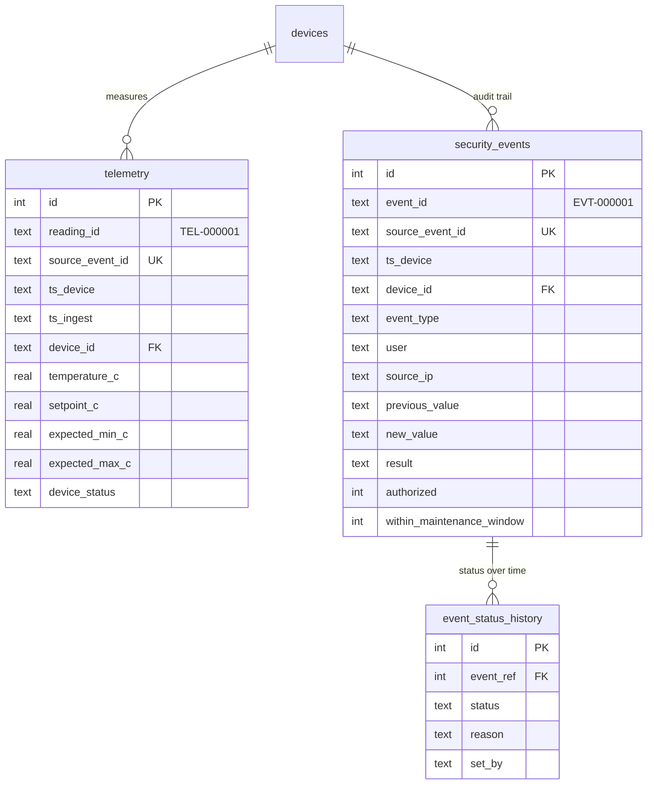

# Smart-FridgeGuard — Centralized Event Database

**Phase:** 2 – Cybersecurity detection engine
**Step:** 7 – Build the event logging system
**Status:** Done (2026-11-14)
**Related:** [architecture.md](architecture.md) component 4 · [simulation.md](simulation.md) (event sources)

---

## 1. Purpose

Every event from the simulators is validated, normalised and stored in one SQLite
database, `data/fridgeguard.db` (git-ignored). This is the single source of truth for the
detection engine, the SOC dashboard and incident reports.

```powershell
python -m fridgeguard simulate --duration 3d --show none   # fills data/fridgeguard.db
python -m fridgeguard events stats
python -m fridgeguard events list --status suspicious
```

## 2. Two kinds of events

| | **Temperature telemetry** | **Security audit events** |
|---|---|---|
| Table | `telemetry` | `security_events` |
| ID | `TEL-000001` | `EVT-000001` |
| Answers | *What did the sensor measure?* | *Who did what, when, from where?* |
| Contains | temperature, setpoint, expected range, device status, door, compressor | user, role, source IP, event type, previous/new value, result, authorization, maintenance window |
| User / source IP | **none, by design** | always required |
| Status | device status (`ok`, `out_of_range`, …) | security status (`normal`, `suspicious`, `malicious`) |

The split is deliberate. A temperature reading shows **that** a fridge warmed up (or that its
setpoint is now 10 °C). It cannot show **who** changed the setting or whether they were
allowed to. That evidence lives only in the audit trail. Keeping them apart means:

- the database refuses telemetry that carries a user or IP (it would be a spoofed attribution);
- an investigation joins the two on device and time: "the temperature rose at 02:40, and the
  audit trail shows `maintenance_tech` raised the setpoint at 02:02 from 10.10.1.30";
- the high-volume telemetry (1 440 readings per fridge per day at one per minute, 4 320 for the
  fleet) does not slow down queries on the much smaller audit trail (about 15–20 events per day).

## 3. Centralized event structure

Every security event has these fields. Queries use the view `v_security_events`.

| Field | Column | Example |
|-------|--------|---------|
| Event ID | `event_id` | `EVT-000019` |
| Timestamp | `timestamp` (ISO 8601 UTC, ms) | `2026-11-17T02:02:00.546Z` |
| Device | `device` | `FRIDGE-002` |
| Event type | `event_type` | `SETPOINT_CHANGE` |
| User | `user` (username used or attempted) | `maintenance_tech` |
| Previous value | `previous_value` | `-18.0 °C` |
| New value | `new_value` | `-17.0 °C` |
| Source IP | `source_ip` | `10.10.1.30` |
| Status | `status` | `suspicious` |

Additional fields: `role`, `result` (success / failure / logout / applied / denied /
rejected), `reason` (e.g. `bad_password`, `unknown_user`), `authorized`,
`within_maintenance_window`, `status_reason`, `status_set_by`, `scenario` (simulator ground
truth, never used for detection).

### Event types

| Event type | Category | Source |
|------------|----------|--------|
| `LOGIN_SUCCESS` | authentication | successful password login |
| `LOGIN_FAILURE` | authentication | wrong password or non-existent account |
| `LOGOUT` | authentication | end of session |
| `SETPOINT_CHANGE` | configuration | `setpoint_c` |
| `ALARM_THRESHOLD_CHANGE` | configuration | `alarm_low_c`, `alarm_high_c` |
| `CONFIG_CHANGE` | configuration | other settings (`defrost_interval_h`) |
| `FIRMWARE_UPDATE` | configuration | `firmware_version` |

Denied and rejected changes are stored too, with `result = denied` or `rejected`. An attempt
matters as much as a success.

## 4. Status of security events

Each security event gets a first status when it is stored. Later steps can raise it.
Statuses are never overwritten: every change is a new row in `event_status_history`, and the
view shows the latest.

| Set by | When | Example |
|--------|------|---------|
| `ingest` | When the event is stored (Step 7) | `suspicious`: privileged account active outside the maintenance window |
| `DET-00x` | Detection rule matched (Step 8, [detection-rules.md](detection-rules.md)) | `malicious`: DET-001 unauthorized setpoint change that was applied |
| analyst name | Triage in the dashboard (later step) | `normal`: confirmed emergency repair |

Checks at ingest are based only on facts the device reported. They are deliberately simple
and are **not** detection rules (no thresholds, no time windows, no correlation):

| Condition | Status |
|-----------|--------|
| Configuration change with `authorized: false` (role lacks the permission) | suspicious |
| Configuration change with `authorized` missing or not true/false (agreed DR-4 logic: never assume authorised) | suspicious |
| Technician or admin **logged in or changed a setting** outside the maintenance window | suspicious |
| Login attempt for an account that does not exist | suspicious |
| Anything else (including a single mistyped password) | normal |

The ingest check flags **daytime** changes outside the maintenance window as suspicious. This
closes the gap noted under DR-4 in requirements.md: they no longer go unnoticed, although they
are still not *alerts*.

In a 7-day simulation every baseline (normal) event is stored as `normal`, and every injected
off-hours or unauthorised setpoint change is stored as `suspicious` (checked by the tests).

## 5. Reliability and integrity

| Requirement | How |
|-------------|-----|
| Reliable storage (NFR-2) | SQLite transactions, WAL journal (a reader never blocks the writer). Commits are batched: about once a second while events arrive, or every 1 000 events, and always on exit. |
| No duplicates | `source_event_id` (the simulator's UUID) is unique; re-importing a log adds nothing. |
| Append-only | Triggers abort any `UPDATE` or `DELETE` on `telemetry`, `security_events`, `event_status_history`, `rejected_events`. |
| Nothing silently dropped | Invalid events go to `rejected_events` with the reason. |
| Tamper evidence (NFR-5) | Each row keeps the original event (`raw_json`) and its SHA-256 `hash`. Events whose hash does not match their content are rejected at ingest. `events verify` re-checks every stored row. |
| Clear timestamps (NFR-1) | `ts_device` (device clock) and `ts_ingest` (when stored) in ISO 8601 UTC. In simulations the ingest time is the simulated time. |
| Least privilege | `events list/stats/verify` open the database read-only (`mode=ro`). |

Validation at ingest: known device, valid timestamp, hash matches content, required payload
fields present, known configuration parameter, telemetry without user/IP, security events with
user and IP.

## 6. Command-line access

```
python -m fridgeguard events stats
python -m fridgeguard events list [--device FRIDGE-001] [--type SETPOINT_CHANGE] [--user NAME]
                                  [--status suspicious] [--since 2026-11-17T00:00] [--until ...]
                                  [--limit 50 | 0 for all]
python -m fridgeguard events telemetry [--device FRIDGE-001] [--since ...] [--limit 20]
python -m fridgeguard events history EVT-000019
python -m fridgeguard events verify
python -m fridgeguard events import data/events.jsonl
```

`simulate` writes to the database by default (`--db -` disables it, `--db other.db` changes it).

### Example output (seed 42, 3 simulated days)

`events stats`:

```
database          data\fridgeguard.db
devices           3
telemetry         12960
security events   50
rejected events   0
time range (UTC)  2026-11-16T04:00:00.000Z .. 2026-11-19T03:59:00.000Z
by type:    LOGIN_SUCCESS 15, LOGOUT 15, LOGIN_FAILURE 11, SETPOINT_CHANGE 6, FIRMWARE_UPDATE 2, CONFIG_CHANGE 1
by status:  normal 39, suspicious 11
```

`events list --since 2026-11-17T01:55 --until 2026-11-17T16:20 --limit 0`:

```
Event ID    Timestamp (UTC)   Device      Event type             User              Previous       New  Result   Source IP       Status
EVT-000018  2026-11-17 02:00  FRIDGE-002  LOGIN_SUCCESS          maintenance_tech                      success  10.10.1.30      Suspicious
EVT-000019  2026-11-17 02:02  FRIDGE-002  SETPOINT_CHANGE        maintenance_tech  -18.0 °C  -17.0 °C  applied  10.10.1.30      Suspicious
EVT-000020  2026-11-17 02:10  FRIDGE-002  LOGOUT                 maintenance_tech                      logout   10.10.1.30      Normal
EVT-000021  2026-11-17 05:18  FRIDGE-003  LOGIN_SUCCESS          system_admin                          success  10.10.1.21      Normal
EVT-000022  2026-11-17 05:22  FRIDGE-003  FIRMWARE_UPDATE        system_admin         2.4.1     2.4.2  applied  10.10.1.21      Normal
EVT-000023  2026-11-17 05:34  FRIDGE-003  LOGOUT                 system_admin                          logout   10.10.1.21      Normal
EVT-000024  2026-11-17 05:47  FRIDGE-003  LOGIN_SUCCESS          store_manager                         success  10.10.1.20      Normal
EVT-000025  2026-11-17 05:53  FRIDGE-003  LOGOUT                 store_manager                         logout   10.10.1.20      Normal
EVT-000026  2026-11-17 05:54  FRIDGE-003  LOGIN_SUCCESS          maintenance_tech                      success  10.10.1.30      Normal
EVT-000027  2026-11-17 05:57  FRIDGE-003  SETPOINT_CHANGE        maintenance_tech    4.5 °C    4.0 °C  applied  10.10.1.30      Normal
EVT-000028  2026-11-17 06:15  FRIDGE-003  LOGOUT                 maintenance_tech                      logout   10.10.1.30      Normal
EVT-000029  2026-11-17 16:11  FRIDGE-003  LOGIN_SUCCESS          store_manager                         success  10.10.1.20      Normal
EVT-000030  2026-11-17 16:12  FRIDGE-003  SETPOINT_CHANGE        store_manager       4.0 °C    6.0 °C  denied   10.10.1.20      Suspicious
EVT-000031  2026-11-17 16:14  FRIDGE-003  LOGOUT                 store_manager                         logout   10.10.1.20      Normal
```

The same technician account is `Normal` at 05:57 (inside the maintenance window) and
`Suspicious` at 02:02 (outside it). The manager's attempt is stored with `denied`; the
fridge was not changed.

`events history EVT-000019`:

```
2026-11-17T02:02:00.546Z  suspicious  set by ingest    privileged account active outside the maintenance window
```

`events telemetry --device FRIDGE-001 --until 2026-11-16T04:06 --limit 5`:

```
Reading ID  Timestamp (UTC)   Device          Temp  Setpoint  Expected range    Status
TEL-000004  2026-11-16 04:01  FRIDGE-001    3.6 °C    4.0 °C  2.0..8.0 °C       ok
TEL-000007  2026-11-16 04:02  FRIDGE-001    3.6 °C    4.0 °C  2.0..8.0 °C       ok
TEL-000010  2026-11-16 04:03  FRIDGE-001    4.0 °C    4.0 °C  2.0..8.0 °C       ok
TEL-000013  2026-11-16 04:04  FRIDGE-001    3.8 °C    4.0 °C  2.0..8.0 °C       ok
TEL-000016  2026-11-16 04:05  FRIDGE-001    4.1 °C    4.0 °C  2.0..8.0 °C       ok
```

`events verify`:

```
OK: all 13010 stored events match their SHA-256 hash
```

## 7. Using the database from Python and SQL

```python
from fridgeguard.storage import EventStore

store = EventStore("data/fridgeguard.db", read_only=True)
changes = store.security_events(event_type="SETPOINT_CHANGE", status="suspicious")
readings = store.telemetry(device="FRIDGE-002", since="2026-11-17T02:00", until="2026-11-17T04:00")
```

```python
import sqlite3, pandas as pd

con = sqlite3.connect("file:data/fridgeguard.db?mode=ro", uri=True)
pd.read_sql("SELECT * FROM v_security_events WHERE status != 'normal'", con)
```

Useful SQL:

```sql
-- failed logins per source IP
SELECT source_ip, COUNT(*) FROM security_events
WHERE event_type = 'LOGIN_FAILURE' GROUP BY source_ip ORDER BY 2 DESC;

-- temperature on FRIDGE-002 around the off-hours setpoint change
SELECT ts_device, temperature_c, setpoint_c FROM telemetry
WHERE device_id = 'FRIDGE-002' AND ts_device BETWEEN '2026-11-17T01:50' AND '2026-11-17T04:00';
```

## 8. Schema

Full DDL: [`fridgeguard/storage/schema.sql`](../fridgeguard/storage/schema.sql).



Other objects: `devices` (registered from `config/devices.yaml`), `rejected_events`,
`schema_info` (schema version), views `v_event_status` and `v_security_events`.

## 9. Code map

| File | Responsibility |
|------|----------------|
| `fridgeguard/storage/schema.sql` | Tables, indexes, append-only triggers, views |
| `fridgeguard/storage/normalize.py` | Validation, event-type mapping, initial status |
| `fridgeguard/storage/store.py` | `EventStore`: ingest, status history, queries, integrity check, JSONL import |
| `fridgeguard/sinks.py` → `SQLiteSink` | Feeds simulator events into the store with batched commits |
| `fridgeguard/__main__.py` | `simulate --db`, `events …` commands |
| `tests/test_event_store.py` | 31 tests: schema, separation, field mapping, status, duplicates, rejection, append-only, tamper detection, end-to-end, CLI |
