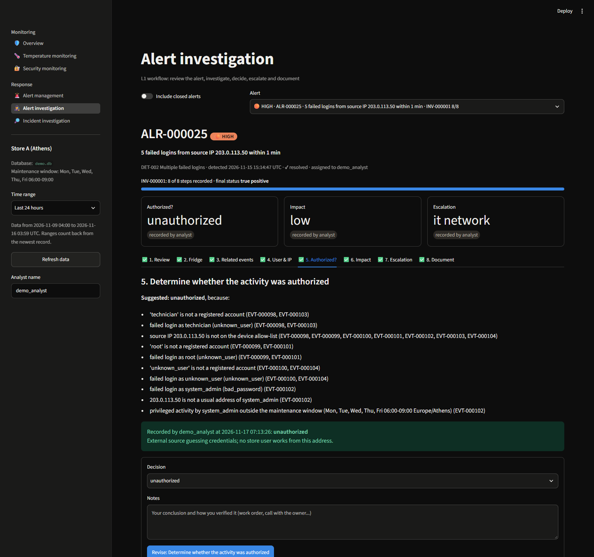

# Smart-FridgeGuard — Incident Investigation Workflow

**Phase:** 3 – SOC dashboard and incident response
**Step:** 12 – Build the incident investigation workflow
**Status:** Done (2026-11-17)
**Related:** [alert-management.md](alert-management.md) · [correlation.md](correlation.md) ·
[soc-dashboard.md](soc-dashboard.md) · [requirements.md](../requirements.md) FR-9, NFR-5

---

Step 12 simulates the job of an **L1 SOC analyst**. When an alert arrives, the analyst
works through a fixed workflow, records what they checked and decided, escalates when
needed, and produces a downloadable **incident report** in Markdown or PDF.

The system does the legwork: it gathers the evidence for every step and *suggests* the
three judgement calls (authorized? impact? escalate to whom?) with the reasons behind
them. The analyst decides. Every report says which decisions were **recorded by an
analyst** and which are only **suggested, not confirmed**.

Example report: [examples/INV-000001.md](examples/INV-000001.md) ·
[PDF](examples/INV-000001.pdf). Blank template:
[templates/incident-report.md](../templates/incident-report.md).



## 1. Quick start

Dashboard: **Response → Alert investigation**, or *Investigate this alert* on the Alert
management page. CLI:

```powershell
python -m fridgeguard investigate start ALR-000025          # opens INV-000001, assigns the alert to you
python -m fridgeguard investigate show INV-000001           # evidence, suggestions, progress

python -m fridgeguard investigate record INV-000001 review_alert --note "Valid alert: 7 failed logins in 1 min"
python -m fridgeguard investigate record INV-000001 authorization --decision unauthorized --note "External source guessing credentials"
python -m fridgeguard investigate record INV-000001 impact --decision low --note "No login succeeded, nothing changed"
python -m fridgeguard investigate record INV-000001 escalation --decision it_network --note "Block 203.0.113.50 at the firewall"
python -m fridgeguard investigate record INV-000001 documentation --decision true_positive --note "Credential guessing, stopped by authentication"

python -m fridgeguard investigate report INV-000001 --format pdf     # -> reports/INV-000001.pdf
python -m fridgeguard investigate list
```

## 2. The workflow

| # | Analyst duty | What the system gathers | Analyst records |
|---|--------------|-------------------------|-----------------|
| 1 | Review the alert | rule, description, severity and why, evidence records, triage history, questions to answer (playbook) | notes |
| 2 | Identify the affected refrigerator | name, location, type (safety-critical stock?), expected range, allowed IPs, temperature at the alert, excursions and telemetry gaps around it, chart | notes |
| 3 | Examine the related events | security events on the device or from the same source IPs / sessions from 2 h before to 1 h after, flagged when they are evidence; other alerts on the fridge | notes |
| 4 | Investigate the user and source IP | per user: registered?, role, permissions, usual IPs, 7-day logins / failures / changes / off-window logins. Per IP: on the allow-list?, whose usual address, failed / successful logins, usernames tried, devices | notes |
| 5 | Determine whether the activity was authorized | **suggestion** + reasons | `authorized` · `unauthorized` · `unknown` · `not_applicable` |
| 6 | Assess the potential impact | **suggestion** + reasons | `none` · `low` · `medium` · `high` · `critical` |
| 7 | Escalate if necessary | **suggested teams** + reasons | `not_required` · `l2_soc` · `maintenance_engineering` · `store_management` · `it_network` |
| 8 | Document the investigation | | final status `true_positive` · `false_positive` · `benign` · `escalated` · `undetermined` + summary |

Rules of the workflow:

- **Starting** an investigation assigns the alert to the analyst and moves it from `new`
  to `under_investigation` (Step 10 workflow). One investigation per alert.
- **Every step needs a note** saying what was checked and found.
- **Answers are append-only.** Recording a step again revises it: the latest answer
  counts, earlier ones stay in `investigation_entries` and the report says how many were
  revised.
- **Documentation comes last.** It is refused until authorization, impact and escalation
  are recorded.
- **The final status moves the alert** through the triage workflow:

| Final status | Alert moves to |
|--------------|----------------|
| `true_positive` | confirmed → resolved (evidence events marked malicious) |
| `escalated` | confirmed (stays open with the team it went to) |
| `false_positive` | false_positive (evidence events marked normal) |
| `benign` | resolved (real but authorized or harmless) |
| `undetermined` | stays under investigation |

## 3. How the suggestions are made

Deterministic rules over the stored data, in
[`fridgeguard/investigation/case.py`](../fridgeguard/investigation/case.py). The activity
judged is the alert's security evidence. For a temperature or heartbeat alert without user
evidence, it is the configuration changes made on the device before the alert.

**Authorized?**

| Finding | Effect |
|---------|--------|
| unregistered account, failed login, change refused (role lacks the permission), source IP not on the device allow-list, applied change the role has no permission for | `unauthorized` |
| only: IP is not the user's usual address, or privileged activity outside the maintenance window | `unknown`: confirm with the account owner, directly and not through the account |
| none of the above | `authorized` |
| no user activity at all (sensor or device problem) | `not_applicable` |

**Impact** takes the highest level any finding reaches:

| Finding | Level |
|---------|-------|
| attempts only, nothing got in | low |
| a setting was changed; short excursion (< 2 °C and < 15 min); telemetry missing | medium |
| unauthorized login succeeded; excursion ≥ 2 °C or ≥ 15 min (stock may be unsafe); CRITICAL alert | high |
| excursion on a fridge with safety-critical stock (pharmacy); unauthorized change followed by an excursion | critical |

An excursion only counts when the alert can explain it: always for a temperature alert,
otherwise only if it started after an applied change. An excursion that merely overlaps
the window is listed as *context*. Without this rule, a brute-force burst would be
reported as "stock at risk" because of an unrelated equipment excursion that started earlier.

**Escalation** lists every team that applies. The first one is the suggested decision:

| Condition | Team |
|-----------|------|
| unauthorized activity that got in (login or applied change), or a CRITICAL alert, or unconfirmed account misuse with high impact | `l2_soc` |
| temperature or heartbeat alert without tampering | `maintenance_engineering` |
| an explained excursion with high impact | `store_management` (quarantine / disposal) |
| a source IP off the allow-list | `it_network` (block, review remote access) |
| unconfirmed account use with low/medium impact | none yet: *escalate to l2_soc if the owner does not confirm* |

Teams, impact level meanings, look-back windows and a **playbook per rule** (what to verify,
recommended response) are configured in
[`config/investigation.yaml`](../config/investigation.yaml). When the alert belongs to a
correlated incident, the incident's questions and response
([correlation.md](correlation.md)) are used as well.

### Results on the seeded week

| Alert | Suggested | Why |
|-------|-----------|-----|
| DET-002 brute force from 203.0.113.50 (no login succeeded) | unauthorized · low · `it_network` | unregistered usernames, external IP; nothing got in |
| DET-004 maintenance_tech at 04:00 + setpoint change | unknown · medium · not required yet | allowed IP, valid account, but outside the window: confirm with the owner |
| DET-003 dairy fridge 9.9 °C above range, no change before it | not applicable · high · `maintenance_engineering` + `store_management` | equipment problem; 76 min out of range inside the examined window (2 h before to 1 h after the alert) |
| DET-001 store_manager change refused | unauthorized · low · not required | refused by RBAC, nothing changed |
| test story: brute force → takeover → setpoint 4 → 12 °C | unauthorized · critical · `l2_soc` + `store_management` + `it_network` | external IP, login succeeded, change applied, fridge warmed |

## 4. The incident report

[`fridgeguard/investigation/report.py`](../fridgeguard/investigation/report.py) builds
the report once as a list of sections and blocks. A Markdown renderer and a PDF renderer
(fpdf2, A4, page numbers) draw the same blocks, so both formats always match. Layout
(the SOC template):

```
INCIDENT REPORT
Incident ID:      INV-000001 (correlated incident INC-… when there is one)
Detection time:   UTC and site local time
Affected device:  ID, name, location
Alert severity:   current (base)

1. Initial alert            alert, rule, description, severity reason, ATT&CK, incident, analyst review
2. Investigation performed  the 8 steps: state, analyst, time, decision, notes; questions to verify
3. Evidence collected       evidence records, refrigerator facts, users, source IPs, other alerts, integrity
4. Event timeline           security events, excursion start/end, alert, triage changes, analyst steps
5. Findings                 authorized? with the analyst's finding and the basis from the evidence; summary
6. Potential impact         level, meaning, analyst assessment, basis
7. Recommended response     playbook / incident response
8. Escalation decision      team, analyst note, suggested teams with reasons
9. Final status             final status, alert status, documented by, report generated
```

**Evidence integrity (NFR-5, control C-15):** while the report is built, every evidence
record is re-verified against its stored SHA-256 hash. The report states *"N of N
evidence records re-verified"* and prints a SHA-256 of the whole evidence set. Anyone can
regenerate the report later and compare the hash; a modified record is named in the
report.

Downloads: dashboard (Markdown and PDF buttons + preview) and
`investigate report --format md|pdf --out <file or folder>` (default `reports/`, git-ignored).

## 5. Storage

Schema version 5. Older databases are upgraded when opened.

| Table / view | Content |
|--------------|---------|
| `investigations` | `INV-000001`, the alert (unique), opened at / by. Cannot be deleted. |
| `investigation_entries` | step, decision, note, analyst, time (append-only triggers) |
| `v_investigations` | investigations with alert, steps done, last update and final status |

## 6. Code map

| File | Role |
|------|------|
| [`fridgeguard/investigation/case.py`](../fridgeguard/investigation/case.py) | `Settings`, `build_case` (evidence gathering), suggestions, timeline, evidence integrity |
| [`fridgeguard/investigation/workflow.py`](../fridgeguard/investigation/workflow.py) | `start`, `record`, final status → alert status |
| [`fridgeguard/investigation/report.py`](../fridgeguard/investigation/report.py) | `build_report`, `to_markdown`, `to_pdf`, `render` |
| [`config/investigation.yaml`](../config/investigation.yaml) | windows, teams, impact levels, playbooks per rule |
| [`dashboard/views/investigation.py`](../dashboard/views/investigation.py) | dashboard page: tabs per step, forms, timeline, downloads |
| [`fridgeguard/storage/store.py`](../fridgeguard/storage/store.py) | `open_investigation`, `add_investigation_entry`, `move_alert_to`, … |
| [`tests/test_investigation.py`](../tests/test_investigation.py) | suggestions per scenario, workflow rules, final status mapping, append-only, report template order, PDF, integrity and tamper detection, schema upgrade, CLI |
