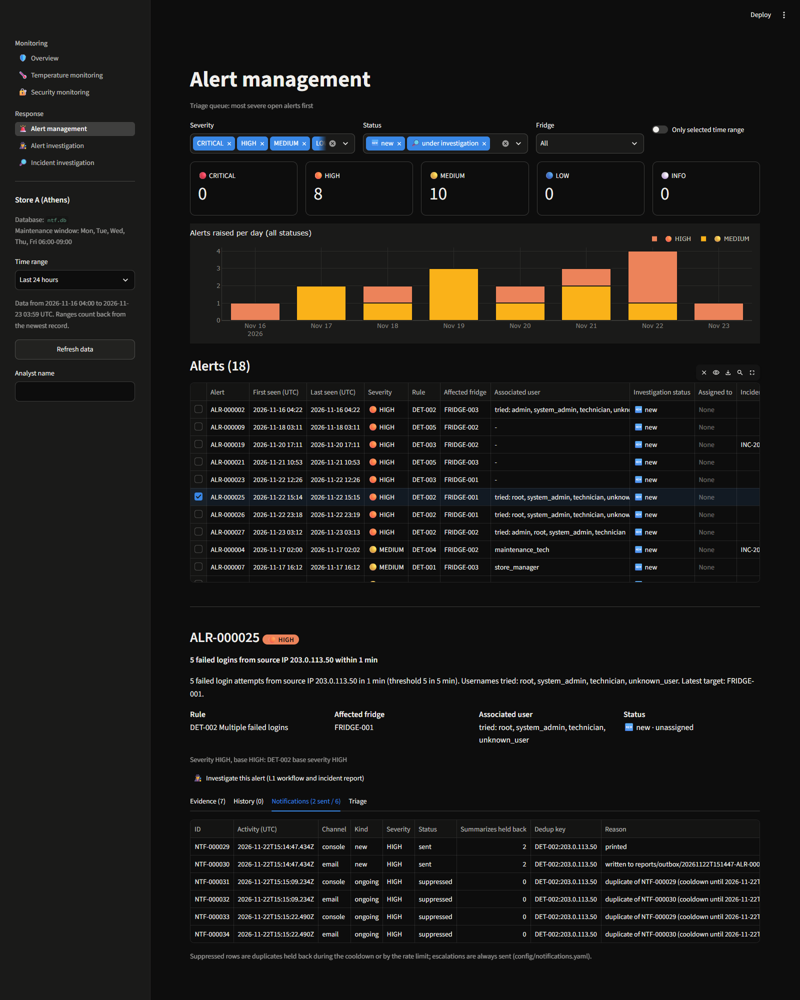

# Smart-FridgeGuard — Notifications

**Phase:** 3 – SOC dashboard and incident response
**Step:** 13 – Implement notifications
**Status:** Done (2026-11-17)
**Related:** [alert-management.md](alert-management.md) · [correlation.md](correlation.md) ·
[investigation.md](investigation.md) · [requirements.md](../requirements.md) FR-6

---

Important alerts reach the analyst without them watching the dashboard: on the **console**,
by **email** and, optionally, on **Telegram**. The notifier **deduplicates**, so one
ongoing incident does not send hundreds of identical messages: a brute force of 300
attempts over 2.5 hours produces 296 rule hits and **3 notifications**.

## 1. Quick start

```powershell
python -m fridgeguard simulate --duration 7d --faults-per-day 0.5 --show none   # notifies live
python -m fridgeguard detect                  # notifies new alerts (add --no-notify to skip)

python -m fridgeguard notify channels         # what is configured (secrets shown as "(set)")
python -m fridgeguard notify test email       # send a test message through one channel
python -m fridgeguard notify run              # notify stored alerts not handled yet, retry failures
python -m fridgeguard notify list --alert ALR-000025
python -m fridgeguard notify stats
```

Console output during a simulated week:

```
🔔 NOTIFY 2026-11-16 04:22:12Z 🟠 HIGH     ALR-000002 5 failed logins from source IP 203.0.113.50 within 1 min
🔔 NOTIFY 2026-11-17 02:00:53Z 🟡 MEDIUM   ALR-000004 maintenance_tech logged in on FRIDGE-002 at Tue 04:00 local time, outside maintenance hours
🔔 NOTIFY 2026-11-18 03:11:00Z 🟠 HIGH     ALR-000009 No readings from FRIDGE-002 for more than 3 min
...
🔔 NOTIFY 2026-11-22 23:18:34Z 🟠 HIGH     ALR-000026 5 failed logins from source IP 203.0.113.50 within 1 min  [+2 held back since 2026-11-22 15:15 UTC]
# notifications: console 18 sent / 14 suppressed; email 8 sent / 10 suppressed
```

## 2. Channels

| Channel | Default | Minimum severity | Delivery |
|---------|---------|------------------|----------|
| Console | on | MEDIUM | one line per notification on stdout (`🔔 NOTIFY …`) |
| Email | on, **file mode** | HIGH | `file`: an `.eml` per message in `reports/outbox/` (opens in any mail client; no server needed). `smtp`: sent through an SMTP server (STARTTLS and login supported) |
| Telegram | off (opt-in) | HIGH | Bot API `sendMessage`, HTML formatted, link to the investigation page |

Every message says what happened, the severity, the alert and rule, the fridge, the time
in UTC and site time, the correlated incident (if any), how many similar notifications
were held back, and how to investigate: a dashboard link
(`…/investigation?alert=ALR-…`) and the CLI command.
Example: [notification-ALR-000025.eml](examples/notification-ALR-000025.eml). CRITICAL
emails carry `X-Priority: 1`.

### Configuration and secrets

Non-secret settings are in [`config/notifications.yaml`](../config/notifications.yaml).
Secrets **only** come from the environment or a git-ignored `.env` file (see
[`.env.example`](../.env.example)). The CLI loads `.env` at start without overriding real
environment variables.

| Variable | Use |
|----------|-----|
| `FRIDGEGUARD_EMAIL_MODE` | `file` or `smtp` |
| `FRIDGEGUARD_EMAIL_OUTBOX` | folder for `.eml` files (file mode) |
| `FRIDGEGUARD_SMTP_HOST`, `_PORT`, `_FROM`, `_TO` | server, sender, comma-separated recipients |
| `FRIDGEGUARD_SMTP_USER`, `_PASSWORD` | SMTP login (secret) |
| `FRIDGEGUARD_TELEGRAM_TOKEN`, `_CHAT_ID` | bot token from @BotFather (secret) and chat |

Secrets never appear in output: `notify channels` prints `(set)` / `(not set)`, SMTP
errors name only host and port, and Telegram errors have the token replaced by `***`.

**Testing email with a real server:** run [Mailpit](https://mailpit.axllent.org/)
(`docker run -p 1025:1025 -p 8025:8025 axllent/mailpit`), set
`FRIDGEGUARD_EMAIL_MODE=smtp`, then `notify test email` and open http://localhost:8025.

**Telegram:** create a bot with @BotFather, send it a message, get the chat ID from
`https://api.telegram.org/bot<token>/getUpdates`, put both in `.env` and set
`telegram.enabled: true`.

## 3. Deduplication

The detector reports every **rule hit**: a new alert, or another hit on an alert that is
still active (the brute force keeps failing, the fridge keeps warming). For each channel
the notifier decides:

| Decision | When | Result |
|----------|------|--------|
| **new** | first notification for the deduplication key, or the key comes back after a quiet period | sent |
| **duplicate** | same key within the cooldown (1 h), same or lower severity | suppressed, logged as *duplicate of NTF-…* |
| **escalated** | same key, higher severity than the last notification sent, even during the cooldown | sent: *ESCALATED HIGH -> CRITICAL* |
| **ongoing** | activity continues after the cooldown | one reminder: *STILL ONGOING … [+N held back since …]* |
| **rate limit** | more than 20 sent on a channel in one hour (storm protection) | suppressed; **CRITICAL always goes through** |

- **Deduplication key:** the correlated incident when the alert belongs to one (all the
  alerts of one attack share it), otherwise rule + subject (e.g. `DET-002:203.0.113.50`,
  `DET-003:FRIDGE-001`).
- **Escalations of earlier alerts:** re-prioritization can make an older alert more
  severe (an unauthorized change becomes CRITICAL when the fridge warms). After each hit
  the notifier checks the fridge's open alerts and notifies such escalations at once.
- **Time:** decisions use the alert activity time, so a simulated week behaves like a
  real one and results are reproducible.
- **Threshold:** alerts below a channel's minimum severity are not sent or logged (INFO
  maintenance records never notify).
- **Only open alerts:** alerts already confirmed, resolved or marked false positive are
  not notified again.

### Results

| Scenario | Rule hits | Sent | Held back |
|----------|----------:|-----:|----------:|
| One brute-force burst (7 attempts) | 3 | 1 | 2 |
| Sustained brute force, 300 attempts in 2.5 h ([test](../tests/test_notifications.py)) | 296 | 3 (new + 2 hourly reminders, each "+119 held back") | 293 |
| Seeded simulated week, console channel | 32 | 18 | 14 |
| Seeded simulated week, email channel (HIGH+) | 18 | 8 | 10 |

## 4. Reliability

- **Idempotent.** Every decision is appended to the `notifications` table, which is
  also the state. Re-running `detect` over the same events or `notify run` never sends
  a notification twice: activity at or before the last decision for an alert is skipped.
- **Failures don't stop detection.** A channel error (SMTP down, Telegram unreachable)
  is logged with status `failed` and the reason; the next `notify run` retries alerts
  that have no successful or suppressed decision.
- **Audit.** `notify list` and the **Notifications** tab of each alert on the Alert
  management page show every decision with its reason.



## 5. Storage

Schema version 6 (older databases are upgraded when opened).

| Column | Content |
|--------|---------|
| `notification_id` | `NTF-000001` |
| `ts` / `created_at` | alert activity time / wall-clock time of the decision |
| `channel`, `alert_id`, `incident_id`, `dedup_key` | what and where |
| `kind` | `new`, `escalated`, `ongoing`, `test` |
| `severity`, `status` | `sent`, `suppressed`, `failed` |
| `reason` | delivery note, *duplicate of NTF-… (cooldown until …)*, rate limit, or the error |
| `held_back` | how many suppressed notifications a reminder summarizes |
| `subject` | message subject |

The table is append-only (triggers block UPDATE and DELETE).

## 6. Code map

| File | Role |
|------|------|
| [`fridgeguard/notifications/notifier.py`](../fridgeguard/notifications/notifier.py) | `Notifier` (decisions, dedup, escalations, rate limit, `process_stored`, `send_test`), `Settings`, `build_channels` |
| [`fridgeguard/notifications/channels.py`](../fridgeguard/notifications/channels.py) | `Message`, `ConsoleChannel`, `EmailChannel` (file / SMTP), `TelegramChannel` |
| [`config/notifications.yaml`](../config/notifications.yaml) | cooldown, rate limit, channels and thresholds |
| [`fridgeguard/config.py`](../fridgeguard/config.py) | `load_dotenv` |
| [`tests/test_notifications.py`](../tests/test_notifications.py) | dedup, cooldown reminder, quiet-gap, escalation, rate limit, thresholds, re-runs, failure + retry, incident key, sustained attack, console / file / real-socket SMTP / Telegram (mocked HTTP), secret redaction, `.env`, CLI |
