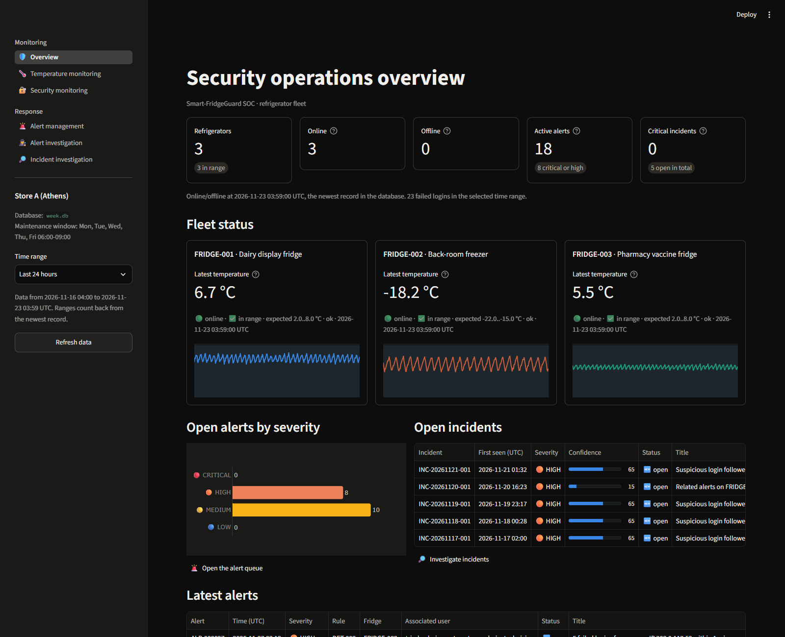
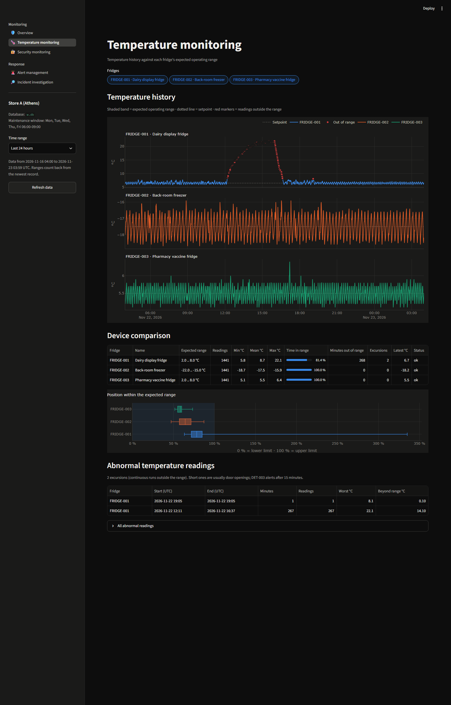
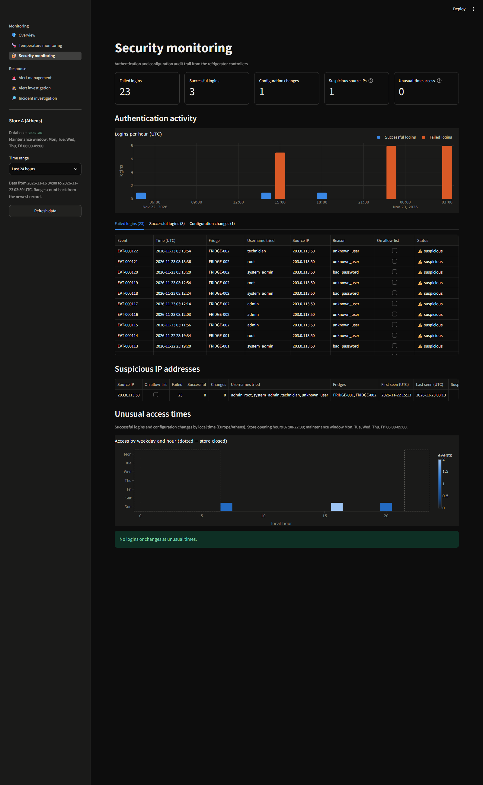
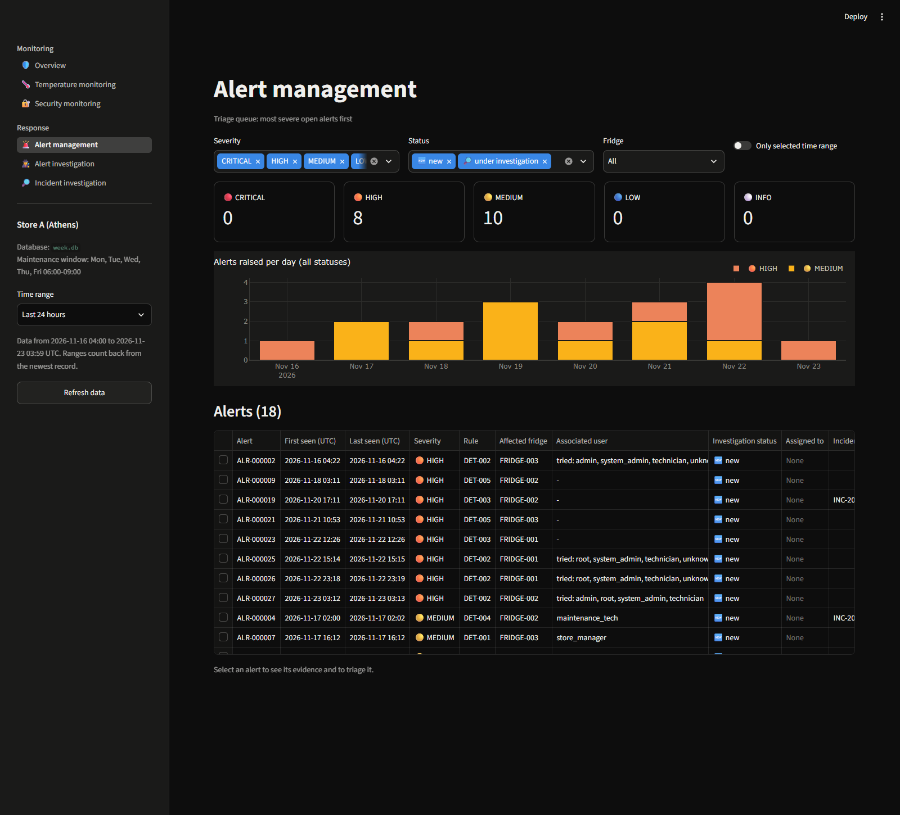
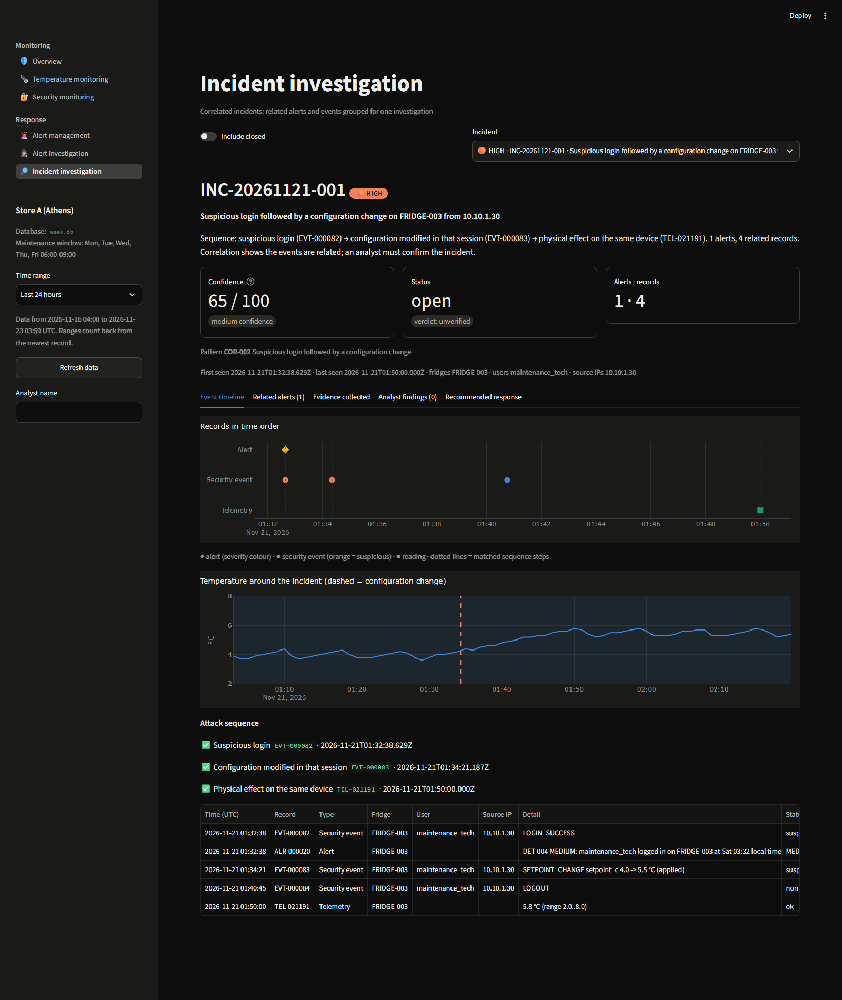
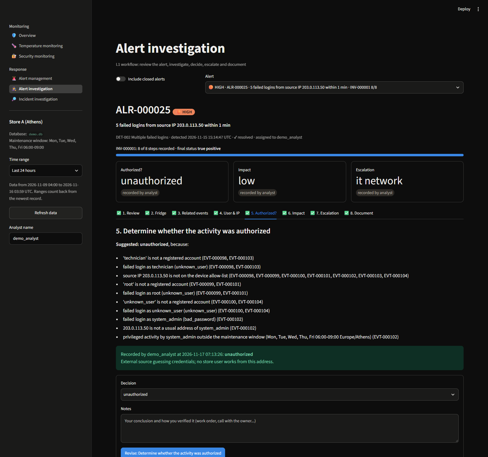

# Smart-FridgeGuard — SOC Dashboard

**Phase:** 3 – SOC dashboard and incident response
**Step:** 11 – Build the SOC dashboard
**Status:** Done (2026-11-16, overview metrics aligned with the spec 2026-11-17)
**Related:** [alert-management.md](alert-management.md) · [correlation.md](correlation.md) ·
[investigation.md](investigation.md) · [requirements.md](../requirements.md) FR-8

---

A Streamlit + Plotly dashboard for the analyst on shift. It reads the event database and
answers four questions: *Is the fleet healthy? Is anyone attacking it? What needs my
attention first? What exactly happened?*



## 1. Quick start

```powershell
python -m fridgeguard simulate --duration 7d --faults-per-day 0.5 --show none
streamlit run dashboard/app.py
```

- Database: `data/fridgeguard.db`, or set `$env:FRIDGEGUARD_DB` to another file.
- Analyst name for audited actions: the sidebar field, pre-filled from `$env:FRIDGEGUARD_ANALYST`.
- The sidebar's **time range** (6 h … all data) counts back from the newest record, so a
  simulated week from the future still shows "the last 24 hours".

## 2. Pages

| Section (spec) | Page | What it shows |
|----------------|------|---------------|
| 1. Overview | **Overview** | Total refrigerators, devices online, devices offline, active alerts (with how many are critical/high), critical incidents (with how many are open); one card per fridge (online/offline, latest temperature, in/out of range, sparkline with the expected band); open alerts by severity; open incidents with confidence; latest alerts |
| 2. Temperature monitoring | **Temperature monitoring** | Temperature history per fridge with its expected operating range (small multiples, one y-axis each); abnormal readings and excursions (start, duration, worst value); device comparison (min/mean/max, time in range, minutes out, excursions) and the position of every reading within its range |
| 3. Security monitoring | **Security monitoring** | Failed vs. successful logins over time; tables of failed logins, successful logins and configuration changes (old → new value, result, authorized); suspicious IP addresses (off the allow-list or failing logins: usernames tried, devices, first/last seen); unusual access times (store closed, or privileged access outside the maintenance window) and a weekday × hour heatmap |
| 4. Alert management | **Alert management** | Triage queue with severity, timestamps, affected fridge, associated user, investigation status, assignee and incident; alerts per day by severity; per-alert evidence, history, notifications sent or held back (Step 13), status changes and severity override (all written to `alert_history`); link to the investigation |
| 5. Incident investigation | **Alert investigation** (Step 12) | The L1 workflow for one alert, ending in a Markdown/PDF incident report, see [investigation.md](investigation.md) |
| | **Incident investigation** | A correlated incident: event timeline (alerts, events, readings in lanes), temperature around the incident, attack sequence, related alerts, evidence collected (confidence factors, entities, links), analyst findings (append-only reviews) and recommended response |

### Online / offline

A fridge is **online** when its latest reading is at most *expected interval × missed
intervals* old (3 min). That is the same setting the DET-005 missing-heartbeat rule uses
(`config/detection.yaml`), so the dashboard and the alert never disagree. "Now" is the
newest record in the database, which makes simulated data from any date behave like live
data.

## 3. Design

- **Status colour is never the only signal.** Severity chips carry the icon and the name
  (🔴 CRITICAL, 🟠 HIGH, 🟡 MEDIUM, 🔵 LOW, ⚪ INFO), and status icons carry the label.
- **Fixed colour roles** ([`theme.py`](../fridgeguard/dashboard/theme.py)): one hue per
  fridge in a fixed order (filters never repaint a device), reserved severity colours, one
  sequential blue ramp for the heatmap. Light and dark palettes follow the Streamlit theme.
- **One y-axis per chart.** Fridges with different ranges (freezer −22..−15 °C, fridges
  2..8 °C) get small multiples instead of a shared axis.
- **Read-only by default.** Pages open the database read-only and cache queries (keyed on
  the database file's modification time, so new data shows up on refresh). Only the
  audited actions (alert status/severity, incident review, investigation steps) open it
  for writing, for that one action.
- **No auto-discovered pages.** Pages live in `dashboard/views/` and are registered with
  `st.navigation` in [`dashboard/app.py`](../dashboard/app.py). A folder called `pages/`
  would make Streamlit add every file a second time.

## 4. Screenshots

| | |
|---|---|
|  |  |
|  |  |



Screenshots come from the seed-42 week (`simulate --duration 7d --faults-per-day 0.5`).
The alert investigation uses the same week started on 9 Nov, so that the analyst's
actions come after the events they review.

## 5. Code map

| File | Role |
|------|------|
| [`dashboard/app.py`](../dashboard/app.py) | entry point, page registration (`st.navigation`) |
| `dashboard/views/*.py` | one file per page |
| [`fridgeguard/dashboard/data.py`](../fridgeguard/dashboard/data.py) | pure data functions (DataFrames, no Streamlit), unit-tested: telemetry, excursions, device comparison, device status, security events, suspicious IPs, unusual access, alerts, incidents |
| [`fridgeguard/dashboard/ui.py`](../fridgeguard/dashboard/ui.py) | page header + sidebar, cached loaders, labels, audited writes |
| [`fridgeguard/dashboard/theme.py`](../fridgeguard/dashboard/theme.py) | palettes and chart styling |
| [`tests/test_dashboard.py`](../tests/test_dashboard.py) | data layer tests and Streamlit `AppTest` runs of every page (with data and without a database), incident review and investigation from the UI |
